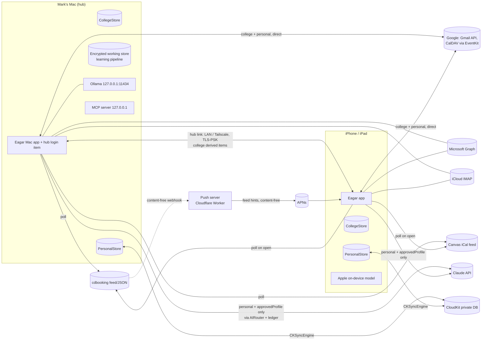
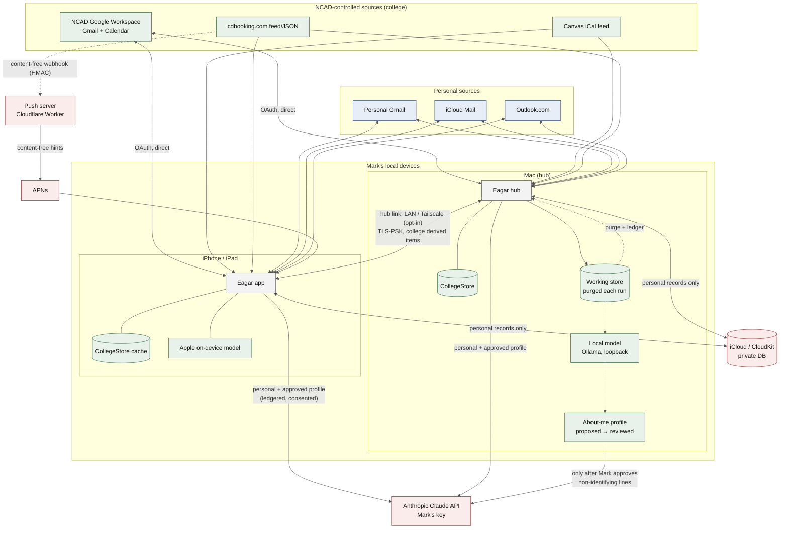

# Eagar — Product Requirements Document

| | |
|---|---|
| **Product** | Eagar (working name; Irish *eagar*, "order, arrangement") |
| **Document** | PRD.md |
| **Version** | 1.0 (first full draft) |
| **Date** | 25 October 2026 |
| **Status** | Draft for owner review. Binding decisions are final unless Mark changes them and records the change in `docs/DECISIONS.md`. |
| **Owner** | Mark, Digital Technical Officer, NCAD (publisher: Mark's company) |
| **Inputs** | `RESEARCH.md` (25 Oct 2026, primary input) and the underlying research notes. Section references below use the form **[R: section name]**. |
| **Executor** | Claude Code in VS Code, one milestone at a time (see `CLAUDE.md`) |

---

## 1. Summary

Eagar is a native, open-source personal organiser for iPhone, iPad and Mac, built from one multiplatform SwiftUI codebase. It replaces the habit of checking several apps and devices with **one brief delivered at natural breaks**. The brief covers appointments, deadlines, NCAD equipment and room bookings (cdbooking), Canvas deadlines, free trials and subscriptions, people to keep in touch with, a budgeted podcast and YouTube backlog, and multi-account email ranked by source account.

Three properties set it apart [R: introduction; Novel features]:

1. **Per-source data boundaries, enforced in code.** Every record carries a data class. College data (NCAD mail, the NCAD calendar, Canvas, cdbooking) is processed only on Mark's own devices, by Apple's on-device model or a local model on his 48 GB Mac. It never reaches Claude, Apple Private Cloud Compute, iCloud sync or iCloud Backup. Personal data may use the Claude API under Mark's own key, with consent per feature. The only thing derived from college data that may reach the cloud is Mark's reviewed, non-identifying "About me" profile: lines learned from his NCAD mail may go to Claude as generic context about how he works and writes, once he has approved each line (OD-4).
2. **Approve-before-send is absolute.** No email leaves without Mark's explicit approval of that exact message. Automation makes each approval cheaper and better explained; it never removes him from the loop. This extends the principle of his existing Windows mail app.
3. **Rules first, AI second, cloud last.** Deterministic rules work everywhere, including a rules-only mode with no AI at all. Local AI handles anything sensitive. The cloud is reached only through one gateway that writes a privacy ledger entry, with the exact payload, before every call.

Mark's own use of the NCAD account is authorised for him alone. The product therefore also produces a **pilot governance pack** (IT allowlisting request, DPIA outline, data-flow diagram, pilot metrics) as evidence for extending Eagar to other NCAD staff. It is not a precondition for Mark's use.

## 2. Goals

| ID | Goal |
|---|---|
| G1 | Reduce the time Mark spends checking multiple apps and devices by consolidating his day into one brief, delivered at natural breaks. |
| G2 | Keep college data on Mark's local devices, provably: the boundary is enforced in the data model, AI router, sync layer and OS integrations, and it is covered by automated tests. |
| G3 | Make email triage and replies faster without ever sending without approval: lanes by source account, thread states, drafts in his style, playbooks, and guards. |
| G4 | Learn Mark's working style locally (download → analyse → delete → reviewed profile) so AI help needs no lengthy onboarding. |
| G5 | Treat media as a budget, not a feed: a podcast player and YouTube subscription manager that share one attention budget. |
| G6 | Produce evidence (approval ledger, privacy ledger, pilot metrics, DPIA draft) that could justify a governed rollout to other NCAD staff. |
| G7 | Ship as an open-source App Store app that complies with App Review, Google API, YouTube API Services and GDPR requirements. |

## 3. Non-goals

| ID | Non-goal | Reason |
|---|---|---|
| NG1 | Sending any email without explicit approval of that message, on any account, by any path. | Binding principle (BD-11). |
| NG2 | Downloading, caching, background-playing or audio-extracting YouTube media; scraping YouTube transcripts. | YouTube policies; App Store 5.2.3 [R: Constraints › YouTube]. |
| NG3 | Reading the Apple Podcasts library, other apps' App Store subscriptions, Mail.app, iMessage, WhatsApp, call history or Screen Time data. | No sanctioned API [R: Constraints › Apple]. |
| NG4 | Bank or open-banking linking. | Impractical for an individual in Ireland [R: Constraints › Other]. |
| NG5 | Any workaround to Workspace admin controls: forwarding work mail, Apps Script export, relaying through another client, scraping. | Out of bounds in every case [R: Mark's decisions]. |
| NG6 | A developer-run server that stores or transmits mail, OAuth tokens or college content. | CASA trigger; data boundary [R: Email]. |
| NG7 | Training or improving any shared AI model on user data, or pooling profiles across users. | Workspace API user data policy permits only "that specific user's personalized model" [R: Constraints › Google]. |
| NG8 | Auto-scheduling Mark's calendar ("plans for you"). Eagar proposes; Mark confirms. | HCI evidence and competitor complaints [R: AI planners]. |
| NG9 | Always-on capture of screen, audio or messages. | Trust and regulatory risk (Rewind/Limitless EU exit) [R: Unified assistants]. |
| NG10 | Android, Windows or web clients. The Windows mail app interoperates only through the shared rules format (Appendix F). | Scope. |
| NG11 | Siri AI features on EU iPhone/iPad as a dependency. App Intents, Shortcuts, Spotlight and widgets are used; Siri AI is optional and macOS-first. | Siri AI unavailable to EU users on iOS/iPadOS 27 [R: Constraints › Apple]. |

## 4. Success metrics

Targets are design targets to be recalibrated after the baseline period; they are not research findings.

| ID | Metric | How measured | Target |
|---|---|---|---|
| SM1 | **Time spent checking multiple apps/devices (proxy).** Weekly pickups and minutes for the apps Eagar replaces (Gmail, Mail, Outlook, Calendar, Podcasts, YouTube, Canvas, cdbooking in Safari). | Screen Time data cannot leave its sandbox [R: Constraints › Apple], so Mark reads iOS/macOS Screen Time weekly and enters the figures into Eagar's Pilot Metrics screen (manual entry, stored locally). Two-week baseline before M3 ships; then weekly. | ≥30% reduction in combined pickups by 8 weeks after M5; no increase in total minutes in Eagar beyond the minutes removed elsewhere. |
| SM2 | Brief completion time | Event log: brief opened → all items actioned, snoozed or dismissed. | Median ≤2 minutes [R: Novel feature 2]. |
| SM3 | Boundary violations | Privacy ledger: cloud calls whose payload class is `college`; blocked attempts; CI boundary test suite. | **Zero** cloud calls carrying college content, ever. Blocked attempts are reported and each one gets a bug fixed. |
| SM4 | Sends without approval | Approval ledger: `sent` events lacking a matching `approved` event with the same content hash. | **Zero.** |
| SM5 | Draft quality | Approval ledger: median normalised word-level edit distance per category, by month. | Falling trend per category over the first 3 months of M4. |
| SM6 | Commitments captured | Commitments extracted from sent mail and confirmed by Mark, per week. | Tracked; no target until baseline. |
| SM7 | Suggestion precision | Suggestion ledger: accepted ÷ (accepted + dismissed). | ≥50% after 4 weeks of M6; daily prompt cap never exceeded. |
| SM8 | Cloud spend | Spend meter (from API `usage`). | < USD 5/month at Mark's usage [R: AI routing]. |
| SM9 | Missed returns and trial charges | Loans returned after due time; trials billed after their cancel-by date while marked "cancel". | Zero after M2. |
| SM10 | Reliability | Crash-free sessions (MetricKit, local); background feed-refresh success. | ≥99.5% crash-free sessions. |

## 5. Personas

### 5.1 Primary: Mark

Digital Technical Officer at NCAD, working across Fine Art Media, Product Design (Interaction) and Communication Design. Master admin of cdbooking.com. Runs local AI infrastructure for NCAD (two DGX Sparks pooled by his Meitheal orchestrator). Uses an Apple Silicon Mac with 48 GB unified memory, an iPhone and an iPad. Develops with Claude Code in VS Code. Has a personal Gmail, iCloud mail and an Outlook/Microsoft account, plus his NCAD Google Workspace account. Has already built a Windows app that downloads his work email with a strict human-in-the-loop rule.

Needs: one calm view of his day across work and personal life; replies drafted in his own voice without losing control; no college data leaving his devices; low setup effort; open, inspectable behaviour he can show to IT and the DPO.

Authority: full authority for this work on his own NCAD account, limited to him only. His own data-protection rule is that no college data leaves his local devices.

### 5.2 Secondary: future NCAD staff (pilot extension)

Academic and technical staff across Mark's three departments, on a mix of Mac and Windows, with Apple devices common. Not developers: they cannot be asked to create Google Cloud projects. Their NCAD account starts in **rules-only mode** (no AI) and in **dry-run** for sending, and can only move up the staged consent ladder (rules-only metadata → local commitment extraction and drafting → local style profile → possibly approved profile to cloud) after institutional approval [R: Novel feature 14]. They need an NCAD-managed OAuth client, IT-visible controls and a single policy artefact shared with the Windows client.

---

## 6. Binding design decisions

Each decision is binding on the implementation. Changing one requires Mark's approval and an entry in `docs/DECISIONS.md`.

### 6.0 Owner decisions (authoritative inputs)

Mark's own decisions, as confirmed on 25 Oct 2026. They override anything else in this PRD or in RESEARCH.md. Rationales below cite them as **OD-n**.

| ID | Owner decision |
|---|---|
| OD-1 | One multiplatform SwiftUI app for iPhone, iPad and Mac. The Claude API with Mark's own key is the first cloud tier; DGX Spark / Meitheal routing comes later. |
| OD-2 | College data (NCAD Google Workspace mail, the NCAD calendar, Canvas, cdbooking) is processed only on Mark's local devices (the 48 GB Mac's local AI and Apple's on-device model) and is never sent to any cloud AI. Mark has authority for this, limited to himself only. |
| OD-3 | Personal accounts may use the Claude API, with the consent that App Store guideline 5.1.2(i) requires. |
| OD-4 | Local learning pipeline: download mail → analyse Mark's own output with local AI → delete the source copies → keep a non-identifying style/workflow profile about him → Mark reviews and approves it → the approved profile **is** sent to the cloud AI as generic information about his workflow and how he writes and responds. This explicitly includes profile lines learned from his NCAD mail. Per-line review and approval, and the non-identifying requirement, remain mandatory. |
| OD-5 | Approve-before-send is absolute. No YouTube downloading. |
| OD-6 | Google Calendar via EventKit; Canvas via its iCal feed early; the Canvas API optional later. |

### BD-01 One multiplatform SwiftUI codebase; minimum OS 26, OS 27 features availability-gated

**Decision.** One Xcode project with a single multiplatform app target for iPhone, iPad and Mac (native macOS, not Mac Catalyst). Deployment targets: **iOS 26.0, iPadOS 26.0, macOS 26.0**. OS 27 APIs (`LanguageModel` protocol wrappers, `PrivateCloudComputeLanguageModel`, the 8,192-token on-device model, `ClaudeForFoundationModels`, new App Intents types such as `OwnershipProvidingEntity` and `UndoableIntent`) are used only behind `if #available(iOS 27, macOS 27, *)`. Swift 6 language mode with strict concurrency. Optional watchOS target only in M6.

**Rationale.** iOS 27 supports exactly the same iPhones as iOS 26 [R: platform notes §1], so a 26 floor costs nothing in device reach while keeping the app usable by people who defer the annual update. Everything the core design needs exists on 26: `SystemLanguageModel` (on-device Foundation Models), SpeechAnalyzer/SpeechTranscriber, `BGContinuedProcessingTask`, SwiftData, CKSyncEngine and WidgetKit Controls. The OS 27 features that a 27 floor would unlock are either not used for the core paths (Claude is reached through Eagar's own REST client, BD-07; PCC is excluded from college data and requires the Small Business Program and a managed entitlement) or are nice-to-haves. Reading `contextSize` at runtime handles the 4,096 vs 8,192 token difference [R: Constraints › Apple; open question 10].

### BD-02 Local-first storage in two physically separate stores; CloudKit private database for personal data only

**Decision.** Two SwiftData stores, each with `cloudKitDatabase: .none`:
- **PersonalStore** (`personal.store`): personal, public-content and approved-profile records. Synced across Mark's devices by an Eagar-owned **CKSyncEngine** layer to a custom zone in the **CloudKit private database**. Sensitive fields (relationship notes, profile lines, ledger payloads) use CloudKit `encryptedValues`.
- **CollegeStore** (`college.store`): all `college`-class records. **Never attached to any sync engine.** Its files are marked `isExcludedFromBackup` and use Data Protection class `completeUntilFirstUserAuthentication` (iOS/iPadOS). It is replicated between Mark's devices only over the Mac hub link (BD-09).

The schema is CloudKit-compatible from M0 (no unique constraints, all relationships optional, all attributes optional or defaulted, no ordered relationships, additive-only changes) even for CollegeStore, so that types can be shared.

**Rationale.** CKSyncEngine gives explicit conflict control and deduplication across many entity types; SwiftData's built-in CloudKit mirroring resolves conflicts as last-writer-wins (per a secondary source) and offers no per-record placement control [R: Data and sync]. Physical separation makes the college boundary auditable: there is no code path by which a college record can enter a sync engine, because the store it lives in has none. iCloud Backup would otherwise copy the app container to iCloud, which would break Mark's rule.

### BD-03 Every record carries a data class; derived items inherit the most restrictive class

**Decision.** Every persisted model type conforms to `Classified` and stores a non-optional `dataClass` (defaulted at the type level for CloudKit compatibility, and validated on insert). Classes:

| `DataClass` | Meaning | Example sources |
|---|---|---|
| `college` | NCAD-controlled data, including anything derived from it. Local devices only. | NCAD mail, NCAD Google calendar, Canvas, cdbooking |
| `personal` | Mark's own personal data. Cloud AI allowed per feature with consent. | Personal Gmail, iCloud, Outlook, personal calendars, contacts, trials |
| `publicContent` | Public metadata. Any tier, subject to the source's own policy (e.g. YouTube 30-day rule). | Podcast RSS, podcast transcripts, YouTube titles/descriptions |
| `approvedProfile` | An approved About-me profile version (or approved lines). Cloud AI as context. | Output of the learning pipeline after Mark's approval |

**Taint rule:** any record or AI payload derived from inputs takes the most restrictive class among them (`college` > `personal` > `approvedProfile` > `publicContent`). The **only** declassification path is the profile approval flow (BD-10), which turns reviewed, linted profile lines into `approvedProfile`.

**Rationale.** OD-2; [R: AI routing by data class]. Enforcement in the data model rather than the UI is what makes the boundary testable.

### BD-04 The college boundary covers every egress path, not just AI

**Decision.** For `college` data, Eagar must not use, and must actively disable where the OS would otherwise do so:

| Egress path | Rule |
|---|---|
| Claude API, any cloud AI, Apple PCC | Never. Router blocks and logs (BD-06). |
| DGX Sparks via Meitheal | Never, until Mark decides they count as local devices (Open question Q11). Controlled by `Policy.meithealIsLocal = false`. |
| CloudKit / iCloud sync | Never for content. Content-free state (e.g. a "done" flag keyed to a message ID) only if Mark enables the separate setting `collegeContentFreeSync` (default **off**, Q4). |
| iCloud Backup | College store, working store and caches excluded from backup. |
| Push notifications | Payloads for college items are content-free ("3 replies ready to approve"). |
| Notification content shown on device | Content-free for college items by default (setting may allow sender name locally). |
| Widgets, Live Activities, Lock Screen, Control Center | Counts or content-free labels for college items by default. |
| Spotlight, App Intents donations, `NSUserActivity`/Handoff | No college content donated or indexed. |
| Apple Intelligence Writing Tools in college composers | Disabled (`writingToolsBehavior` set to disabled; to verify per OS). |
| Share sheet / copy | Allowed only as an explicit user action; never automated. |
| MCP server to cloud-backed clients | Redacted to free/busy and counts (BD-28). |
| Push server (Cloudflare) | Never holds college content; relays content-free hints only (BD-16). |
| Logs, crash reports, diagnostics | Never contain message bodies, subjects or addresses for any class (BD-25). |

**Rationale.** OD-2; [R: Work-mail sync without the cloud; Novel feature 13]. Several of these paths (backup, Writing Tools, Spotlight, notification summaries) are not obvious and would silently break the rule if left at OS defaults.

### BD-05 Per-source processing modes and per-class tier pins

**Decision.** Every source (mail account, calendar, feed, contact set) has a **processing mode**:

| Mode | AI allowed | Default for |
|---|---|---|
| `rulesOnly` | None. Deterministic rules only. | Any new work account; any account in a staff rollout without institutional approval |
| `localAI` | Apple on-device; Mac local model | Mark's NCAD account and all college sources |
| `cloudAllowed` | Local tiers plus Claude, per feature, with consent | Mark's personal accounts |

Settings also let Mark pin any (data class, content kind) to a maximum tier [R: Novel feature 15]. Defaults: `college/*` → local; `personal/rawBody` → local, raised to Claude only by an explicit per-account, per-feature consent (e.g. "Draft replies on Personal Gmail with Claude"); `personal/derivedItem` → Claude with consent; `publicContent/*` → any; `approvedProfile` → Claude.

**Rationale.** OD-2 and OD-3. RESEARCH.md restricts raw personal bodies to local tiers in its routing table but allows Claude for personal data elsewhere; this PRD resolves the conflict by allowing it as an explicit opt-in while defaulting to data minimisation (see §13, Inconsistencies resolved).

### BD-06 One AI gateway: `LLMProvider` protocol plus a router that is the only way to reach a provider

**Decision.** All model calls go through `AIRouter` in the `EagarAI` package. Providers implement `LLMProvider` and accept only a `RoutedCall`, a type whose initialiser has `package` access and is created only by the router after the policy check. Feature code cannot construct a `RoutedCall` or call a provider directly. Each provider declares capability flags, including **data locality**. The router computes the effective data class of the payload (taint rule), checks processing mode, tier pins, consent and locality, writes the privacy ledger entry for any off-device call, then dispatches. Blocked attempts are logged. Sketch in §7.4.

**Rationale.** [R: AI routing; Novel feature 12]. A compile-time capability token turns "every call goes through the gateway" from a convention into something the compiler enforces.

### BD-07 Claude via a thin in-house REST client with Mark's own key (BYOK)

**Decision.**
- Eagar implements its own `/v1/messages` client on `URLSession` (streaming SSE, tools, structured outputs via `output_config.format` with `type: json_schema`, `cache_control`). No official Swift SDK exists; `ClaudeForFoundationModels` is beta, OS 27-only, lacks token counting and batch, and labels `.apiKey` auth "development only" [R: Constraints › Claude].
- The API key is stored in the Keychain with `kSecAttrAccessibleWhenUnlockedThisDeviceOnly`, `kSecAttrSynchronizable = false`. It is entered separately on each device (separate keys per device are recommended, so one can be revoked alone). It is never logged, never synced, never sent anywhere except `api.anthropic.com`.
- **App Attest is not used.** It bills the developer's workspace and suits a developer-pays model, not BYOK [R: platform notes §3].
- Onboarding guides Mark to create a **dedicated Claude workspace with a monthly spend limit and an expiring key**, and offers a "test key" check [R: Novel feature 18].
- Default models (IDs from the Claude models overview, verified 25 Oct 2026): `claude-haiku-5-5` for classification and short extraction on personal data; `claude-sonnet-5-5` for brief phrasing, weekly review and planning; `claude-opus-5-5` only when Mark selects it. `claude-fable-5-1` is not offered by default because it requires 30-day retention [R: platform notes §3]. Model IDs and prices live in a bundled, updatable table, not in code.
- **Message Batches are never used for personal content** (not ZDR-eligible, 29-day retention). Batches may be used only for already-anonymised aggregates.
- `inference_geo` is left at default (`global`); the consent screens disclose that processing may happen outside the EU and that workspace data is stored in the US [R: Constraints › Claude].

### BD-08 Local AI: Apple on-device on every device; Ollama on the Mac as the primary local runtime; MLX optional

**Decision.**
- **Apple Foundation Models (on-device `SystemLanguageModel`)** on iPhone, iPad and Mac for short classification and extraction: one fresh session per item, `@Generable` outputs, prompts sized to the runtime `contextSize`. If `availability` is not `.available`, the feature falls back to the Mac hub or to rules.
- **Ollama on the Mac** is the primary heavy local runtime, reached through the generic `AnthropicCompatibleProvider` at `http://127.0.0.1:11434` (its `/v1/messages` endpoint). Eagar sets `num_ctx` explicitly per request (default context of 4,096 silently truncates threads), and treats missing features via capability flags: no prompt caching, no `tool_choice`, no token counting, no batch. Structured output is validated client-side against the JSON Schema with one bounded retry.
- **MLX** is an optional second local provider (via `MLXLanguageModel` on macOS 27 or an MLX server), added only if the M4 benchmark shows a clear throughput or quality advantage on Mark's 48 GB Mac.
- Model class: 20–30B-class instruction models that fit comfortably in 48 GB with room for the OS and app; the exact model is chosen by the M4 benchmark and recorded in `docs/DECISIONS.md`.

**Rationale.** Ollama exposes the same Anthropic-shaped `/v1/messages` surface as vLLM behind Meitheal, so one provider implementation covers the Mac now and the DGX Sparks later [R: AI routing]. Mark already runs Ollama-based local AI in his lab work. Ollama does not validate API keys and must never be exposed beyond loopback; iPhone and iPad never talk to Ollama directly, only to the Eagar hub (BD-09).

### BD-09 The Mac is the hub for college data; iPhone/iPad reach it directly over the local network or Tailscale

**Decision.** The Mac app runs a hub service (login item registered with `SMAppService`) that polls sources continuously, runs local models and the learning pipeline, and serves derived college items (drafts, summaries, commitments, brief sections, approval queue) to Mark's paired iPhone and iPad over a direct connection: Bonjour on the local network, or the Mac's Tailscale address when away. Transport: Network.framework with TLS 1.3 using a pre-shared key established at pairing (QR code plus confirmation code), stored in each device's Keychain this-device-only. Each device also fetches raw college mail directly from Google with its own OAuth grant, so no new party is added. If the Mac is unreachable, iPhone/iPad fall back to their own on-device model or to rules.

**Rationale.** [R: Work-mail sync without the cloud; Approvals happen in batches]. Tailscale traffic is end-to-end encrypted WireGuard even when relayed (general knowledge); whether that satisfies "no college data leaves my local devices" is Open question Q4. Until Mark answers, the hub link works on the local network out of the box and Tailscale is an explicit opt-in setting.

### BD-10 Local learning pipeline: download → strip → analyse → aggregate → purge → review

**Decision.** Runs only on the Mac, overnight on AC power or when Mark starts it. ON for the NCAD account from the start; OFF by default for any other work account. Stages and rules are specified in §8.12 (FR-LEARN). The output is a versioned **About-me profile** of categorical, non-identifying lines, each tagged `workDerived` or `personalDerived` (the tag is provenance for audit and the DPIA, not a cloud filter). A lint step rejects names, email addresses, phone numbers, quoted text and identifiers. Mark approves, edits or deletes each line; only approved lines are declassified to `approvedProfile`, and **approved lines are sent to Claude as context whether they are work-derived or personal-derived** (OD-4). A per-line `sendToCloud` switch (default `true` once approved) lets Mark hold back an individual line without deleting it. Each cloud call records which profile version it used. "Delete the source emails" means purging Eagar's own downloaded working copies, never deleting from the mail server (Q2 confirms). The profile is per-user and is never pooled.

**Rationale.** OD-4; [R: Local learning pipeline; Constraints › Google, Workspace policy "specific user's personalized model"]. Mark has decided that approved lines learned from NCAD mail may go to the cloud; per-line review, the lint and the non-identifying requirement are what make that declassification safe.

### BD-11 Approve-before-send is absolute

**Decision.** No message is sent from any account without an `ApprovalRecord` that binds Mark's approval to a SHA-256 hash of the exact outgoing MIME content (recipients, subject, body, attachment hashes). Any change after approval invalidates it. This applies to every path: manual compose, AI drafts, playbooks, follow-ups, delegation, L3 held sends, App Intents, Shortcuts, Siri, MCP tools, Watch. Each send requires device-owner authentication (Face ID/Touch ID, falling back to passcode). Batched approval is allowed only as a sequence of individual approvals (one gesture and one authentication per message, with an optional "approve this batch" that still shows and authenticates each message). New accounts start in **dry-run** (the send call is replaced by a "would have sent" ledger entry). A **global kill switch** cancels held sends, stops all drafting and AI, and optionally signs out all mail accounts.

**Rationale.** OD-5; [R: Human-in-the-loop email]. Binding the approval to a content hash closes the gap between "approved a draft" and "sent something else".

### BD-12 Graded autonomy per category, earned from evidence, never above L2 on college accounts

**Decision.** Autonomy levels L0–L3 per action category, as in [R: Graded autonomy], **except that no level ever replaces per-message approval** (OD-5, BD-11). Levels never rise automatically: Eagar suggests a promotion with evidence and Mark opts in explicitly per category. Demotion is automatic. In this PRD **L3 means "fast-path approval with a held send"**: for an L3 category, Mark may approve the exact message from a notification action, widget, Watch (M6) or the queue with one gesture plus device-owner authentication, and the approved message is then held locally (on the Mac by preference) for a delay (default 10 minutes) with undo before release. The `ApprovalRecord` and content hash are created at that per-message approval; release after the delay needs no second authentication but is logged. There is **no standing category grant that sends a message Mark has not individually approved.** L3 is not available on college-class accounts (Q6).

**Rationale.** RESEARCH.md sketches L3 as "approved-by-default send" under a category grant, which would contradict OD-5 and NG1. This PRD keeps the evidence-based promotion and the undo window but makes the extra autonomy a cheaper approval, not an absent one. Reinstating a standing-grant L3 would require Mark to change OD-5 explicitly and record it in `docs/DECISIONS.md`.

### BD-13 Email access routes and Google OAuth clients per account

**Decision.**

| Account | Route | Auth | Notes |
|---|---|---|---|
| Personal Gmail | Gmail REST API (`history.list` incremental sync) | Mark's **own Google Cloud OAuth client**, External, Testing status, Mark as test user | Restricted scopes (`gmail.readonly` or `gmail.modify`; `gmail.send` sensitive). **Refresh tokens expire after 7 days in Testing**; Eagar detects `invalid_grant`, shows a one-tap re-consent card in the brief, and keeps working from cache. Mitigation test: move to unverified production under the personal-use exception and observe for 8+ days (to verify). |
| iCloud Mail | IMAP/SMTP (`imap.mail.me.com:993`, `smtp.mail.me.com:587`) via MailCore2 | App-specific password in Keychain | Max 25 app-specific passwords; all revoked on Apple Account password change; Eagar detects auth failure and prompts. |
| Outlook.com / Microsoft 365 | Microsoft Graph | MSAL, delegated `Mail.Read` and `offline_access` (from the research notes); `Mail.ReadWrite` and `Mail.Send` for thread state and sending (general knowledge, to verify against Microsoft Learn in M3) | Tenant consent policies may block work tenants. |
| NCAD Google Workspace | Gmail REST API (default) or IMAP-XOAUTH2, per Q1 | Configurable per account: Mark's own client ID now; **NCAD-managed Internal client** when IT provides it | `admin_policy_enforced` is treated as the correct outcome: Eagar shows a "Request access from IT" path (including the Education "Apps pending review" request) and never a workaround. |

Each account stores its own OAuth client configuration. Gmail data never passes through any developer server. Forwarding work mail to a personal account is never offered.

**Rationale.** [R: Mark's decisions (two OAuth client configurations); Constraints › Google; Email].

### BD-14 Calendar through EventKit; Canvas through its iCal feed first

**Decision.** Calendars (including Google accounts added to Apple Calendar via CalDAV) are read and written through EventKit with **full access** (no read-only mode exists). Eagar stores references (event identifiers) and derived items, not copies of events. Mark marks which calendars are NCAD (`college`); calendars from an account whose address ends in `ncad.ie` are proposed as college automatically. Canvas is ingested through the per-user Canvas calendar feed URL with the same feed pipeline as cdbooking (M2). The Canvas REST API with a personal access token is an optional M6 item. No Google Calendar API in v1.

**Rationale.** OD-6; [R: Google Calendar and Canvas]. Reuses an access path the app needs anyway, with no extra Google scopes.

### BD-15 cdbooking integration through a versioned per-user feed and content-free webhook contract

**Decision.** Eagar consumes the contract in Appendix E: a per-user secret iCal feed, a token-authenticated JSON endpoint, an optional admin-queue summary that returns counts only, and an HMAC-signed webhook whose payload is **content-free**. Mark (as master admin) implements it on cdbooking.com; his planned native CloudKit replacement must publish the same surface so Eagar needs no change at switch-over. Behind a `BookingSource` protocol with a `CDBookingFeedSource` adapter. All cdbooking data is `college`.

**Rationale.** [R: Mark's decisions › cdbooking.com; Calendar, contacts, bookings; platform notes §6].

### BD-16 A tiny push server that never holds college content

**Decision.** A Cloudflare Worker (TypeScript, Cron Triggers, D1, an APNs HTTP/2 client) deployed by Mark. It stores only: podcast feed URLs and YouTube channel feed URLs that Mark registers, ETags/Last-Modified, last-seen item GUIDs, APNs device tokens, and opaque webhook route IDs. It never stores OAuth tokens, mail, calendar data, cdbooking or Canvas content. College sources are polled by the Mac or devices themselves; the Worker only relays content-free "something changed" pushes from the cdbooking webhook. A self-hosted deployment is possible later from the same code but is not a v1 deliverable. The app keeps a client-only fallback (BGAppRefresh plus fetch on open; continuous polling on the Mac).

**Rationale.** [R: Notifications and the tiny push server; open question 12]. Cloudflare costs about $5/month and gives reliable uptime; hosting on NCAD hardware would mix personal and institutional infrastructure (Q12 lets Mark override).

### BD-17 YouTube: list and organise, never download

**Decision.** No downloading, offline caching, background playback, audio separation, ad blocking or player overlays. API metadata is refreshed or deleted within **30 days**; all YouTube data is deleted within **7 days** of in-app disconnection (token revoked immediately). Links open the YouTube app when installed. Optional inline embed on iPad/Mac only, via an embed page hosted on Mark's own HTTPS domain (avoids error 153), at least 200×200 px, autoplay off, no overlays. YouTube items are always visibly labelled and unmodified in mixed views. "YouTube"/"YT" never appears in the app name. AI on YouTube uses title, description and description chapters only. Onboarding works with no OAuth (Takeout `subscriptions.csv` + channel Atom feeds using `UULF` playlists), with `videos.list` (API key) for durations and live status, and `playlistItems.list` as fallback when RSS fails.

**Rationale.** OD-5; [R: Constraints › YouTube; Apple 5.2.3].

### BD-18 Podcasts: RSS is the source of truth

**Decision.** Search via Podcast Index (keyed) and the iTunes Search API (~20 calls/min); RSS feeds are authoritative; Podcasting 2.0 `transcript`, `chapters`, `funding`, `person`, `guid`, `alternateEnclosure` parsed; ID3/MP4 chapters as fallback. Onboarding via OPML import, search, or a user-run Shortcut; never by reading the Apple Podcasts library. Missing transcripts are generated on-device with SpeechAnalyzer/SpeechTranscriber. One background `URLSession` for all enclosure downloads. CarPlay only after the entitlement is granted.

**Rationale.** [R: Calendar, contacts, bookings and media sources; Constraints › Apple].

### BD-19 Privacy ledger of every off-device call

**Decision.** An append-only ledger records, **before** the request is sent: timestamp, destination (provider, region), model, purpose, consent reference, data classes in the payload, **the exact payload sent** (viewable), and afterwards tokens, cost and outcome. It also records blocked attempts, local purges, MCP exposures, push-server registrations and key tests. Entries about college items record metadata only (never content). Ledger entries for personal-class calls sync via CloudKit with the payload in `encryptedValues`; entries that reference college processing stay on the producing device and replicate over the hub link. Exportable (JSON and CSV) for the DPIA.

**Rationale.** OD-3; [R: Novel feature 12]; App Store 5.1.2(i).

### BD-20 Contextual, per-source, per-feature consent (App Review 5.1.2(i))

**Decision.** Before any personal data goes to a third-party AI, Eagar shows a consent screen naming the data (e.g. "subjects and bodies of messages in Personal Gmail that you ask to draft"), the recipient ("Anthropic, using your API key; processed in the US or globally"), the purpose and how to revoke. Consent is recorded as a `ConsentRecord` and referenced by every ledger entry. Revoking consent takes effect before the next call. No consent screen is offered for college data, because no cloud path exists.

### BD-21 Calm proactivity: one brief at breakpoints, a confidence ladder, "plans with you"

**Decision.** Non-urgent items are batched into the brief, delivered at breakpoints (end of a calendar event, a gap of 15+ minutes, app open, configured slot). Notifications use `passive` or `active` interruption levels; `timeSensitive` only for genuine deadlines (return due within 2 hours, trial billing today). Proactive suggestions pass a two-threshold confidence ladder with a daily cap; thresholds rise during Focus, meetings and teaching. Eagar proposes; Mark confirms.

**Rationale.** [R: Novel features 2, 3; Iqbal & Bailey 2008; Horvitz 1999; Mehrotra 2016].

### BD-22 Shared rules and playbook format: JSON with a published JSON Schema

**Decision.** Lanes, sender rules, guard configuration, playbooks, autonomy grants and the approval-ledger export use a versioned plain-JSON format (`eagar-rules`, `formatVersion` 1.x) with JSON Schema 2020-12 files published in the repo (Appendix F). JSON rather than YAML so that both Swift and the Windows app can parse it without third-party dependencies. Defined in M0; Eagar reads and writes it from M3. College rule files move only over the hub link or a folder Mark controls, not a consumer cloud.

### BD-23 Licence: Mozilla Public License 2.0

**Decision.** Eagar's source is licensed **MPL-2.0**, including the push server.

**Rationale.** MPL-2.0 is a file-level copyleft: changes to Eagar's own files must stay open, while the work can be combined with Apache-2.0 and BSD dependencies (GoogleSignIn, AppAuth, MailCore2) and MSAL (MIT; general knowledge, to verify) and distributed through the App Store; Pocket Casts' iOS app is MPL-2.0 and ships on the App Store [R: Constraints › Other]. It also lets Eagar reuse Pocket Casts files as-is without relicensing problems. GPL-family licences are avoided because of their long-standing tension with App Store terms (general knowledge; to verify if reconsidered). Mark confirms (Q17).

### BD-24 Minimal dependencies, from an allow-list

**Decision.** Third-party code only from this allow-list, each pinned to an exact version and reviewed for recent commit activity before adoption: **GoogleSignIn-iOS** (or **AppAuth-iOS** if multi-client support requires it), **MSAL** (Microsoft), **MailCore2** (iCloud/IMAP, IMAP-XOAUTH2). Everything else is in-house: REST clients, RSS/Atom/OPML parsing (`XMLParser`), iCalendar parsing, JSON Schema validation (the subset Eagar uses), edit distance, MCP JSON-RPC. Adding anything else requires Mark's approval and a `docs/DECISIONS.md` entry. The push server uses only Cloudflare's runtime and one APNs client library, chosen in M5 and approved by Mark.

### BD-25 No third-party analytics; logs never contain secrets or content

**Decision.** No analytics or crash SDKs. Observability is local: `OSLog` through an `EagarLog` wrapper that only accepts `LogSafe` values; signposts; MetricKit payloads kept locally. Secrets, tokens, message bodies, subjects, addresses, transcripts and profile text never appear in logs, crash reports, diagnostics exports or test snapshots. `print` is forbidden outside tests (CI lint).

### BD-26 Keep-in-touch data lives in Eagar

**Decision.** Relationship notes, cadences and interaction logs are Eagar records (`personal`), not contact notes (the `contacts.notes` entitlement blocks public distribution). Contacts access uses the iOS limited-access picker or `ContactAccessButton` where possible. Colleagues seen only in NCAD mail are `college` signals and are excluded from keep-in-touch unless Mark opts the work lane in.

### BD-27 Trials and subscriptions without bank linking

**Decision.** Manual entry first (M2), with share-sheet and screenshot extraction (Vision OCR plus on-device model). Email receipt detection on personal accounts follows in M4, using local extraction. Eagar links out to cancel (`apps.apple.com/account/subscriptions` or the service's page); it cannot cancel anything itself.

### BD-28 MCP server on the Mac, with a per-client data boundary

**Decision.** The Mac hub exposes an MCP server on loopback (`127.0.0.1`, Streamable HTTP, per-client bearer tokens; a stdio shim only if needed by a client, to verify). Each registered client is marked `cloudBacked` (default) or `local`. For cloud-backed clients (Claude Code, Claude Desktop) college content is redacted to free/busy and counts. Tools are read-mostly; any write tool creates items for review, and **no MCP tool can send email**. Every tool call is a privacy ledger entry. Not offered on iOS.

### BD-29 Governance pack is evidence, not a gate

**Decision.** The pilot kit (Appendices A–D) is generated from Eagar's own configuration and ledgers. Mark's own use does not wait for it. Mark should keep written confirmation of his authorisation (scope "limited to Mark only", local processing, approve-before-send) as the first pilot record.


---

## 7. Architecture

### 7.1 Overview



College data moves only along the solid lines between Mark's devices and the original source. CloudKit, Claude and the push server never receive college content.

### 7.2 Repository and module layout

One Xcode project (`Eagar.xcodeproj`) with app and extension targets; all logic lives in local Swift packages so it can be unit-tested with `swift test` and shared with Mark's planned academic-helper app (Q16).

```
eagar/
├── CLAUDE.md  RESEARCH.md  PRD.md  LICENSE (MPL-2.0)  README.md
├── docs/
│   ├── DECISIONS.md            # ADR-style log of decisions and changes to BDs
│   ├── governance/             # generated pilot pack (Appendices A–D templates)
│   ├── benchmarks/             # e.g. m4-local-models.md
│   └── schemas/                # eagar-rules JSON Schemas (Appendix F) and fixtures/
├── App/
│   ├── Eagar.xcodeproj
│   ├── Eagar/                  # multiplatform SwiftUI app target (iOS, iPadOS, macOS)
│   ├── EagarWidgets/           # WidgetKit, Controls (kill switch), Live Activities
│   ├── EagarIntents/           # App Intents extension
│   ├── EagarNotificationService/   # Notification Service Extension (content-free enrichment)
│   ├── EagarHub/               # macOS login item (SMAppService) hosting hub + MCP
│   ├── EagarShare/             # Share extension (trial import from share sheet/screenshots), M2
│   ├── EagarTests/  EagarUITests/  Eagar.xctestplan   # app-level unit/UI tests and shared test plan
│   └── EagarWatch/             # optional, M6
├── Packages/
│   ├── EagarCore/              # DataClass, Classified, IDs, Clock, LogSafe logging, errors
│   ├── EagarStore/             # SwiftData models, PersonalStore/CollegeStore, migrations
│   ├── EagarSync/              # CKSyncEngine layer (PersonalStore only), conflict policy
│   ├── EagarSecurity/          # Keychain, LocalAuthentication, hub pairing keys
│   ├── EagarLedger/            # privacy, approval and suggestion ledgers; exports
│   ├── EagarAI/                # LLMProvider, AIRouter, providers, schemas, spend meter
│   ├── EagarRules/             # rules engine, lanes, guards, eagar-rules codec + validation
│   ├── EagarMail/              # account model, Gmail/Graph/IMAP clients, threads, outbox
│   ├── EagarCompose/           # drafts, approval queue, playbooks, autonomy, edit distance
│   ├── EagarLearning/          # Mac-only pipeline: ingest, strip, analyse, aggregate, purge
│   ├── EagarCalendar/          # EventKit adapter, free/busy, breakpoints, deadlines
│   ├── EagarFeeds/             # generic feed poller (iCal/JSON/RSS/Atom), ETag cache
│   ├── EagarBookings/          # BookingSource protocol, cdbooking adapter
│   ├── EagarCanvas/            # Canvas iCal (M2), REST API (M6)
│   ├── EagarPeople/            # contacts, cadences, social-capacity budget
│   ├── EagarMoney/             # trials and subscriptions
│   ├── EagarMedia/             # podcasts (player, downloads, transcripts), YouTube, budget, clusters
│   ├── EagarBrief/             # brief composition, breakpoint detection, scheduling
│   ├── EagarSuggest/           # event log, scorer, confidence ladder
│   ├── EagarHubKit/            # hub protocol, server (macOS) and client (iOS/iPadOS)
│   ├── EagarMCP/               # MCP server (macOS)
│   └── EagarTestSupport/       # fakes: RecordingProvider, fake mail servers, fixtures, clock
├── PushServer/                 # Cloudflare Worker (TypeScript), wrangler.toml, tests
├── Tools/                      # lint scripts (no print, no secrets in logs), schema checks
└── .github/workflows/          # CI
```

Dependency rule: packages depend downwards only (`EagarCore` ← `EagarStore` ← domain packages ← `EagarBrief`/`EagarSuggest` ← app). Layers, lowest first (a package may import only lower layers, or packages in its own layer without cycles):

1. `EagarCore`
2. `EagarStore`, `EagarSecurity`
3. `EagarLedger`, `EagarSync`, `EagarHubKit`
4. `EagarAI` (uses `EagarHubKit` for `HubRelayProvider`)
5. Domain: `EagarRules`, `EagarFeeds`, `EagarCalendar`, `EagarMail`, `EagarBookings`, `EagarCanvas`, `EagarPeople`, `EagarMoney`, `EagarMedia`, `EagarCompose`, `EagarLearning`
6. `EagarBrief`, `EagarSuggest`, `EagarMCP`
7. App and extension targets

`EagarTestSupport` is test-only and may depend on any layer. Only `EagarAI` may import `FoundationModels` or open network connections to model providers; a CI check enforces this by scanning imports and URL hosts. A package is created when the first milestone that needs it starts, not as an empty shell.

### 7.3 Data model

All models are SwiftData `@Model` classes designed CloudKit-first: no `@Attribute(.unique)`, all relationships optional, every attribute optional or defaulted, no ordered relationships, additive changes only. Logical uniqueness (e.g. one `MailMessageRef` per account and provider ID) is enforced by Eagar's own upsert code and dedup pass, with tests.

Every model conforms to:

```swift
public enum DataClass: String, Codable, Sendable, Comparable {
    case publicContent, approvedProfile, personal, college   // ascending restrictiveness
}

public protocol Classified {
    var dataClass: DataClass { get }
    var sourceID: SourceID? { get }   // nil only for user-authored records
}
```

**Store placement rule:** `college` records are inserted only into `CollegeStore`; any other class only into `PersonalStore`. `StoreRouter.insert(_:)` enforces this and throws on mismatch (tested).

| Entity | Key fields (abridged) | Class | Store / sync |
|---|---|---|---|
| `Source` | kind (mailAccount, calendar, cdbooking, canvas, podcastFeed, youtubeChannel, contacts), displayName, `dataClass`, `processingMode` (rulesOnly/localAI/cloudAllowed), `boundary` (localOnly/cloudAllowed), lane weight, learningEnabled, dryRun | per source | Personal for personal sources; College for college sources (Personal store keeps only an opaque stub ID if `collegeContentFreeSync` is on) |
| `MailAccount` | sourceID, provider (gmail/graph/imap), address, authKind, oauthClientConfigID, lastHistoryID/delta token | per source | as Source; tokens in Keychain only |
| `MailThreadRef` | accountID, providerThreadID, participants hash, lastMessageAt, `state` (needsReply/waiting/delegated/done), checkBackAt, expectedReplyBy, laneScore, laneReason | inherits account | per class |
| `MailMessageRef` | providerMessageID, threadRef, headers digest, from/to (college: local only), sentByMe, hasBodyCached | inherits | per class; **bodies are never persisted in SwiftData**, only in a per-device encrypted cache with TTL |
| `Draft` | threadRef, body, origin (manual/playbook/ai/followUp/delegation), providerUsed, modelID, playbookVersion, profileVersion, guardFindings, contentHash | inherits | per class |
| `ApprovalRecord` | draftID, contentHash, approvedAt, deviceID, authMethod, category, autonomyLevel, outcome (sent/held/cancelled/dryRun) | inherits (college records hold no content) | per class |
| `Commitment` | text (local), dueAt, counterpartyHash, threadRef, status | inherits | per class |
| `Deadline` | title, dueAt, origin (manual/commitment/canvas/booking/trial), reminderOffsets | inherits | per class |
| `Reminder` | link to EventKit reminder ID or internal | inherits | per class |
| `CalendarRef` | EventKit calendar ID, isCollege, includeInBrief | per calendar | per class |
| `BookingItem` | bookingID, kind (equipment/room), title, start, due, status (requested/approved/checkedOut/returned/overdue), location | college | College |
| `CanvasItem` | uid, course, title, dueAt, url | college | College |
| `Trial` / `Subscription` | service, price, currency, period, startedAt, renewsAt, cancelBy, cancelURL, origin (manual/share/email), status | personal | Personal |
| `Person` | contact identifier (optional), displayName, cadenceDays, weekdayPrefs, lastInteractionAt, birthday, `isWorkContact` | personal (work contacts: college) | per class |
| `RelationshipNote` | personID, text | personal | Personal (`encryptedValues`) |
| `Interaction` | personID, at, kind (calendar/mail/manual), sourceID | inherits | per class |
| `PodcastShow` / `Episode` | feedURL, guid, title, duration, enclosureURL, transcriptRef, chaptersRef, played, position, inQueue, triageState | publicContent (play state: personal) | Personal |
| `YouTubeChannel` / `YouTubeVideo` | channelID, videoID, title, duration, liveStatus, fetchedAt (30-day TTL), triageState, watchedLocally | publicContent with `expiresAt` | Personal; purge job enforces TTL |
| `StoryCluster` | member item IDs, rationale (Eagar's own note) | publicContent | Personal |
| `AttentionBudget` | minutesPerDay, minutesPerWeek, bankruptcyThresholdDays | personal | Personal |
| `Playbook` | name, version, trigger, requiredFacts, template, guards, decisionInputs, category, autonomyLevel | per lane (college playbooks: college) | per class |
| `Rule` / `Lane` | eagar-rules objects | per lane | per class |
| `ProfileVersion` / `ProfileLine` | version, createdAt, status (proposed/approved/superseded), lines: text, category, sourceTag (workDerived/personalDerived), approved, sendToCloud (default true once approved) | `college` while proposed (if any work-derived input), `approvedProfile` once approved (work-derived lines included) | proposed: College; approved: Personal |
| `Suggestion` | trigger, evidenceRefs, confidence, outcome, dismissReason, shownAt | inherits | per class |
| `EventLogEntry` | at, kind, subjectRef, features | inherits | per class |
| `LedgerEntry` (privacy) | at, destination, region, modelID, purpose, consentID, payloadClasses, payload (personal only), tokensIn/Out, costUSD, outcome | metadata-only for college | Personal for cloud calls; College for local-processing records |
| `ConsentRecord` | sourceID, feature, provider, grantedAt, revokedAt, textVersion | personal | Personal |
| `PilotMetric` | week, metric, value, origin (manual/derived) | personal (content-free) | Personal |

### 7.4 AI router and provider protocol

```swift
// EagarAI — sketch; names are binding, details may evolve.

public enum DataLocality: Sendable, Equatable {
    case onDevice                     // Apple SystemLanguageModel on this device
    case macLocal                     // Ollama/MLX on Mark's Mac (loopback, or via hub)
    case applePCC                     // Private Cloud Compute
    case selfHostedInstitutional      // Meitheal / DGX Sparks over tailnet
    case anthropicCloud(region: String)   // "global" or "us"
}

public struct ProviderCapabilities: Sendable {
    public var locality: DataLocality
    public var maxContextTokens: Int
    public var supportsPromptCaching: Bool
    public var supportsToolChoice: Bool
    public var supportsStrictSchema: Bool
    public var supportsBatch: Bool
    public var supportsVision: Bool
    public var supportsTokenCounting: Bool
    public var costPerMTokInUSD: Decimal?     // nil for local
    public var costPerMTokOutUSD: Decimal?
}

public protocol LLMProvider: Sendable {
    var id: ProviderID { get }
    func capabilities() async -> ProviderCapabilities
    func reachability() async -> Reachability
    /// Only AIRouter can construct RoutedCall (package-internal initialiser).
    func complete(_ call: RoutedCall) async throws -> LLMResponse
    func stream(_ call: RoutedCall) -> AsyncThrowingStream<LLMEvent, Error>
}

public struct AIRequest: Sendable {
    public var purpose: AIPurpose                 // e.g. .triage, .draftReply, .briefPhrase, .profileAnalysis
    public var inputs: [ClassifiedPayload]        // each carries its DataClass and SourceID
    public var system: String?
    public var tools: [ToolSpec]
    public var outputSchema: JSONSchema?          // structured output
    public var preferredTier: Tier?
}

public struct RoutedCall: Sendable {
    package init(request: AIRequest, effectiveClass: DataClass,
                 ledgerEntryID: LedgerEntryID?, model: ModelID) { … }
    public let request: AIRequest
    public let effectiveClass: DataClass
    public let ledgerEntryID: LedgerEntryID?
    public let model: ModelID
}

public actor AIRouter {
    public func run(_ request: AIRequest) async throws -> LLMResponse
    // 1. effectiveClass = max(inputs.map(\.dataClass))      (taint rule)
    // 2. allowed = PolicyEngine.allowedLocalities(effectiveClass, sources, modes, pins, consents)
    // 3. candidates = providers.filter { allowed.contains($0.locality) && reachable }
    // 4. if none: throw .noPermittedProvider (and fall back to rules in caller)
    // 5. if chosen.locality is off-device: write LedgerEntry BEFORE send; else write local-processing record
    // 6. build RoutedCall, dispatch, validate schema, record usage/cost/outcome
    // Any attempt where a disallowed provider was explicitly requested -> LedgerEntry(.blocked)
}
```

**Policy table (defaults; `PolicyEngine` is pure and exhaustively tested):**

| Effective class | onDevice | macLocal | applePCC | selfHostedInstitutional | anthropicCloud |
|---|---|---|---|---|---|
| `college` | ✅ | ✅ | ❌ | ❌ (until Q11 decided and `meithealIsLocal` set) | ❌ |
| `college` in `rulesOnly` source | ❌ | ❌ | ❌ | ❌ | ❌ |
| `personal` raw body | ✅ | ✅ | ✅ if enabled | ✅ if enabled (M6) | only with per-account, per-feature consent |
| `personal` derived item | ✅ | ✅ | ✅ | ✅ (M6) | ✅ with consent |
| `approvedProfile` | ✅ | ✅ | ✅ | ✅ | ✅ (approved lines with `sendToCloud = true`, work-derived included; OD-4) |
| `publicContent` | ✅ | ✅ | ✅ | ✅ | ✅ |

**Providers:**

| Provider | Locality | Milestone | Notes |
|---|---|---|---|
| `AppleOnDeviceProvider` | onDevice | M0 (stub), M1 | `SystemLanguageModel`; checks `availability`, reads `contextSize`; one session per item |
| `AnthropicProvider` | anthropicCloud | M0 | BYOK REST; `x-api-key`, `anthropic-version` header; structured outputs; `cache_control` for the profile and stable system prompts |
| `AnthropicCompatibleProvider(baseURL, key?, caps)` | macLocal / selfHostedInstitutional | M4 (Ollama), M6 (Meitheal) | Same wire format; capability flags off for caching, `tool_choice`, token counting, batch on Ollama |
| `HubRelayProvider` | macLocal | M4 | On iPhone/iPad: forwards a local-model request to the Mac over the hub link; locality is macLocal |
| `ApplePCCProvider` | applePCC | M6, optional | OS 27, managed entitlement, Small Business Program; never for college |
| `RecordingProvider` (tests) | configurable | M0 | Records every call; used by boundary tests |

Structured outputs: every AI feature defines its output as a Swift `Codable` type plus a JSON Schema (with `additionalProperties: false`) generated from one source, so the same contract is used by Claude (`output_config.format`), by local models (client-side validation and one retry) and, on OS 27, by `@Generable` equivalents.

### 7.5 Sync topology

| Data | Mechanism | Notes |
|---|---|---|
| PersonalStore records | CKSyncEngine, private DB, custom zone `EagarPersonal` | App persists engine state; conflicts resolved per entity: field-level last-writer-wins for simple fields; set-union for tags/queue membership; ledgers append-only (never conflict); `ApprovalRecord` immutable |
| Sensitive personal fields | CloudKit `encryptedValues` | Handle `userDidResetEncryptedDataKey` by re-uploading from the local store |
| CollegeStore records | **Hub replication** over `EagarHubKit` (Mac is authority; iPhone/iPad hold a cache with TTL) | Never CloudKit. Devices also fetch raw mail directly from Google |
| College content-free state (optional) | CKSyncEngine, zone `EagarCollegeState`, records hold only opaque IDs (HMAC of provider message ID with a device-pair key) and enum state | Off by default (`collegeContentFreeSync`, Q4) |
| Keychain items | This-device-only | BYOK key, OAuth tokens, app-specific passwords, hub PSK. Never iCloud Keychain |
| Media downloads, transcripts cache | Per device | Not synced; play positions and queue sync as personal records |
| Widgets / extensions | App Group container, read-only snapshot files | Extensions do not carry the CloudKit entitlement; college snapshot is counts-only by default |

### 7.6 Push server

Cloudflare Worker (TypeScript), deployed with Wrangler from `PushServer/`.

| Component | Detail |
|---|---|
| Storage | D1 tables: `devices(device_token, platform, env, registered_at)`, `feeds(feed_url, kind, etag, last_modified, last_guid, last_polled_at, owner_device_ids)`, `webhooks(route_id, secret_hash, target_device_ids)` |
| Cron | Every 15 minutes: conditional GET of registered podcast and YouTube feeds; on new GUID, send push |
| Pushes | `apns-push-type: background` (`content-available`, priority 5) carrying `{kind: "feed", feedHash}`; fall back to an alert push ("New episode available") if the item is not acknowledged within 60 minutes or per-show "interrupt" rule; `liveactivity` and widget pushes from M5 |
| Webhook relay | `POST /v1/hooks/{route_id}`: verify HMAC-SHA256 of body with the route secret; drop the body; send content-free push `{kind: "bookingChanged"}` |
| Auth | Device registration with a per-install secret generated on device and an admin-issued enrolment token Mark configures (single-tenant deployment); APNs `.p8` key in Worker secrets |
| Never stored | OAuth tokens, Claude keys, mail, calendar, cdbooking/Canvas content, YouTube metadata beyond feed URL and last GUID |
| Retention | Feed rows deleted 7 days after last device unregisters; logs without payloads |

### 7.7 Background execution strategy

| Platform | Mechanism | Used for |
|---|---|---|
| iOS/iPadOS | Foreground sync on launch and scene activation | Mail, feeds, hub refresh |
| iOS/iPadOS | `BGAppRefreshTask` (~30 s, system-scheduled) | Opportunistic mail delta, feed check, reschedule local notifications |
| iOS/iPadOS | `BGProcessingTask` (overnight, power) | Transcription of downloaded episodes, scorer retraining, dedup, TTL purges |
| iOS/iPadOS | `BGContinuedProcessingTask` | User-started long work (e.g. "Transcribe now", large OPML import) |
| iOS/iPadOS | Background `URLSession` (one session, `sessionSendsLaunchEvents`) | Podcast enclosure downloads |
| iOS/iPadOS | Silent push (≤2–3/hour) and alert push from the Worker | New episodes/videos, cdbooking change hints |
| iOS/iPadOS | Local notifications scheduled ahead | Deadlines, return-due, trial cancel-by, birthdays, brief slots, keep-in-touch nudges |
| macOS | Hub login item (`SMAppService`), continuous timers | Mail polling (Gmail `history.list` every 2–5 min; IMAP IDLE where available), cdbooking/Canvas polling every 15 min, learning pipeline, held L3 sends, MCP server |
| macOS | `NSBackgroundActivityScheduler` | Overnight pipeline when on AC power and idle |

Rule: anything time-critical and known in advance is a scheduled local notification; anything triggered externally relies on the Mac hub or the push server, with fetch-on-open as the fallback.

### 7.8 Security

| Area | Requirement |
|---|---|
| Secrets | Keychain only, `WhenUnlockedThisDeviceOnly`, non-synchronizable; access group shared with extensions only where needed (the Notification Service Extension gets no secrets) |
| BYOK | Key entry via secure field; "test key" makes a minimal `/v1/messages` call; key masked in UI after entry; per-device keys recommended; App Attest not used (BD-07) |
| OAuth | PKCE via `ASWebAuthenticationSession`; tokens in Keychain; revoke on account removal; refresh failures surface as a re-consent card |
| At rest | College store, working store and body caches use Data Protection `completeUntilFirstUserAuthentication` (iOS) and are excluded from backup; the learning working store is additionally encrypted with a per-run AES-GCM key (CryptoKit) held only in memory and the Keychain, destroyed at purge, so deleted copies are unrecoverable |
| Hub link | TLS 1.3 PSK from pairing; mutual authentication; device revocation list on the Mac; no listener on non-private interfaces except the Tailscale interface when enabled |
| Ollama | Must bind to loopback; Eagar warns if `OLLAMA_HOST` exposes it beyond loopback (detected by probing the LAN address) |
| MCP | Loopback only; per-client bearer token; write tools create review items only; no send |
| Send | LocalAuthentication per send (`deviceOwnerAuthentication`), content-hash-bound approval |
| App sandbox (macOS) | Sandboxed; entitlements: network client/server (hub, MCP), calendars, contacts, user-selected files (OPML, rules import); no Full Disk Access in the App Store build |
| Supply chain | Allow-listed dependencies pinned by exact version; `Package.resolved` committed; CI fails on unpinned or new dependencies |

### 7.9 Privacy ledger

Implemented in `EagarLedger`. Requirements are in FR-PRIV (§8.13). Ledger entries are written by `AIRouter`, `EagarMCP`, the push-server client, the learning pipeline (purges) and the key tester. The viewer shows, per entry, the exact payload for personal calls, the profile version used, cost and consent; filters by destination, class and date; and a header summary: "Cloud calls carrying college content: 0. Blocked attempts: n."

### 7.10 Observability

- `EagarLog` wraps `os.Logger` with privacy `.private` by default; only `LogSafe` types (enums, counts, durations, opaque IDs) are interpolated publicly.
- Signposts around sync, AI calls, brief composition and the learning pipeline.
- MetricKit payloads (hangs, crashes, energy) stored locally and viewable in Settings › Diagnostics; exported only by Mark's action, after a redaction pass.
- A Diagnostics screen shows background task history (last run, duration, outcome), feed poll success rates, refresh-token expiry dates and hub reachability.
- No third-party analytics (BD-25).

---

## 8. Functional requirements

Each requirement is testable. "Must" is mandatory for the milestone shown; the **FRs delivered** line under each milestone in §10 lists which FRs that milestone delivers. Where an FR touches college data, its test must include a boundary assertion.

### 8.1 Foundations (FR-CORE)

| ID | Requirement |
|---|---|
| FR-CORE-01 | The app builds and runs from one multiplatform target on iOS 26, iPadOS 26 and macOS 26, with OS 27-only code behind availability checks. |
| FR-CORE-02 | Every persisted model conforms to `Classified`; inserting a record whose `dataClass` does not match its store throws `StoreError.classMismatch`. |
| FR-CORE-03 | Derived records compute their class with `DataClass.max(of:)` over their inputs; a unit test covers every derivation function in the codebase (CI fails if a new derivation lacks a test, enforced by a registry). |
| FR-CORE-04 | `Source` setup requires choosing data class and processing mode; any source whose address/host matches the college domain list (`ncad.ie`, `cdbooking.com`, NCAD's Canvas host) defaults to `college` + `localAI` for Mark, or `rulesOnly` for any other user profile. |
| FR-CORE-05 | A first-run flow requests calendar access and one personal inbox and produces a brief within 5 minutes, with defaults for everything else [R: Novel feature 17]. |
| FR-CORE-06 | Settings show, per source: class, mode, boundary icon (house = local-only, cloud = cloud-allowed, lock = rules only), lane weight, dry-run state and learning state. |
| FR-CORE-07 | The global kill switch is reachable from Settings, a Control Center control (`ControlWidgetToggle`, iOS and macOS) and a Shortcut; activating it cancels held sends, stops drafting and all AI calls within 1 second, optionally signs out all mail accounts, and is logged. |

### 8.2 AI router and providers (FR-AI)

| ID | Requirement |
|---|---|
| FR-AI-01 | All model calls go through `AIRouter.run`; providers accept only `RoutedCall`. A CI script fails the build if any file outside `EagarAI` imports `FoundationModels` or references Anthropic/Ollama hosts. |
| FR-AI-02 | The router never dispatches a payload whose effective class is `college` to a provider whose locality is `anthropicCloud`, `applePCC` or (while `meithealIsLocal == false`) `selfHostedInstitutional`; it throws `.boundaryViolation` and writes a `blocked` ledger entry. |
| FR-AI-03 | The router never dispatches any payload from a `rulesOnly` source to any provider. |
| FR-AI-04 | Personal raw message bodies are sent to Claude only if a `ConsentRecord` exists for that account and feature; otherwise the router selects a local provider or fails closed. |
| FR-AI-05 | Provider capability flags drive behaviour: prompt caching only where supported; client-side JSON Schema validation and one retry where strict schema is unsupported; `num_ctx` set explicitly on Ollama. |
| FR-AI-06 | The on-device provider reads `SystemLanguageModel.availability` and `contextSize` at runtime and splits work into fresh sessions sized to fit; it never assumes 4,096 or 8,192. |
| FR-AI-07 | BYOK key entry stores the key in the Keychain this-device-only and validates it with a "test key" call; the key is never displayed in full again, never logged and never included in exports. |
| FR-AI-08 | Model IDs and prices come from a bundled `models.json` (editable in Settings › Advanced); defaults `claude-haiku-5-5`, `claude-sonnet-5-5`; Opus selectable; Fable not offered by default. |
| FR-AI-09 | The spend meter shows cost per call, per feature and per day from API `usage` (input, cache read/write, output tokens) and the price table, with a configurable monthly soft cap that pauses cloud features when reached. |
| FR-AI-10 | Onboarding explains and links to creating a dedicated Claude workspace with a monthly spend limit and an expiring key. |
| FR-AI-11 | No call uses the Message Batches API with personal or college content; batch is available only to an `AnonymisedAggregate` payload type. |
| FR-AI-12 | Each AI output stored in Eagar records provider, model, locality, profile version and playbook version, and shows a locality badge ("On iPhone", "On Mac", "Apple PCC", "Claude (US/global)", "Meitheal (NCAD)"). |

### 8.3 Calendar (FR-CAL)

| ID | Requirement |
|---|---|
| FR-CAL-01 | Request EventKit full access for events and reminders with usage strings that justify full access (no read-only mode exists). |
| FR-CAL-02 | List all EventKit calendars; Mark tags each as college or personal; calendars of accounts on `ncad.ie` are pre-tagged college. |
| FR-CAL-03 | Compute free/busy, conflicts and breakpoints (event end, gaps ≥15 min) deterministically, with no AI, for all calendars including college. |
| FR-CAL-04 | Create and edit events and reminders on a calendar Mark chooses, through EventKit; Eagar never writes college-derived content into a personal calendar (cross-boundary write guard). |
| FR-CAL-05 | Show a unified day/week timeline of events, deadlines, loans, trials' cancel-by dates and media slots (Structured-style single timeline). |
| FR-CAL-06 | Diagnose missing NCAD calendar: if no `ncad.ie` calendar is present, show steps to add the Google account in system Settings and a note that IT may block Apple's client (to verify). |

### 8.4 Deadlines and reminders (FR-DL)

| ID | Requirement |
|---|---|
| FR-DL-01 | Deadlines can be created manually, from confirmed commitments, Canvas items, booking due times and trial cancel-by dates. |
| FR-DL-02 | Each deadline schedules local notifications at configured offsets at sync time; no server needed. |
| FR-DL-03 | Optionally mirror a deadline as an EventKit reminder in a list Mark chooses; college deadlines mirror only to a list on a college or local account (never iCloud Reminders) unless Mark overrides per item. |
| FR-DL-04 | Overdue deadlines appear at the top of the next brief with snooze, done and reschedule actions. |

### 8.5 The Brief (FR-BRIEF)

| ID | Requirement |
|---|---|
| FR-BRIEF-01 | One brief per configured slot (default morning; optional midday and end-of-day) with sections: today's commitments and events, deadlines, due loans, trials about to bill, lane-ranked mail, approval queue count, waiting-on, keep-in-touch, media slice. |
| FR-BRIEF-02 | Delivery is timed to breakpoints: first breakpoint after the slot time (end of event, gap ≥15 min, or app open), with a maximum deferral of 45 minutes. |
| FR-BRIEF-03 | Every item has at least one action (reply/open, snooze, done, return, cancel, queue, dismiss with reason). |
| FR-BRIEF-04 | Composition: deterministic assembly first; optional phrasing by AI. College sections are phrased only by local tiers (or not at all); cloud phrasing receives only personal/public/approvedProfile items. The final brief merges both. |
| FR-BRIEF-05 | Brief notification uses `passive` or `active` level; content-free for college items (counts only) on Lock Screen. |
| FR-BRIEF-06 | Home Screen and Lock Screen widgets mirror the brief; Mac widget too. College items appear as counts by default. |
| FR-BRIEF-07 | Brief is steerable: sections can be reordered, hidden and sized; thumbs up/down per item feeds the event log. |
| FR-BRIEF-08 | Brief opened → fully actioned time is logged (SM2). |

### 8.6 Bookings — cdbooking (FR-BOOK)

| ID | Requirement |
|---|---|
| FR-BOOK-01 | Add a cdbooking source by pasting or scanning the per-user feed URL and API token (Appendix E); store the token in Keychain. |
| FR-BOOK-02 | Poll the JSON endpoint with `since=` and ETag (Mac hub every 15 min; devices on open and BGAppRefresh); fall back to the iCal feed if JSON is unavailable. |
| FR-BOOK-03 | Show bookings and loans with status, due time and location; schedule local return reminders (default 24 h and 2 h before due). |
| FR-BOOK-04 | Check each due time against calendar busy blocks; if it clashes, propose an earlier return slot or open the extension request page [R: Novel feature 6]. |
| FR-BOOK-05 | On a webhook-driven content-free push, refetch from the source; no booking content in any push. |
| FR-BOOK-06 | Admin summary (if Mark's token has admin scope): counts of pending approvals and overdue returns only, with a deep link to cdbooking. |
| FR-BOOK-07 | Live Activity on the due day for an active loan (local start; remote updates from M5). |
| FR-BOOK-08 | `BookingSource` protocol allows a second adapter for the native replacement with no change to consumers. |

### 8.7 Canvas (FR-CANVAS)

| ID | Requirement |
|---|---|
| FR-CANVAS-01 | Add Canvas by pasting the personal calendar feed URL (Canvas › Calendar › Calendar Feed, to verify on NCAD's instance); URL stored in Keychain (it is a bearer secret). |
| FR-CANVAS-02 | Parse VEVENTs into `CanvasItem` and deadlines (assignment due dates, events); all `college`. |
| FR-CANVAS-03 | (M6, optional) Canvas REST API with a personal access token: To Do items and upcoming events, read-only, polled by the Mac hub. |

### 8.8 Trials and subscriptions (FR-TRIAL)

| ID | Requirement |
|---|---|
| FR-TRIAL-01 | Manual entry: service, price, currency (default EUR), period, start, renewal date, cancel URL; cancel-by computed as renewal minus a safety margin (default 2 days). |
| FR-TRIAL-02 | Reminders at 7, 3 and 1 days before cancel-by and on the day (configurable). |
| FR-TRIAL-03 | Share-sheet and screenshot import: Vision OCR then on-device extraction into a proposed trial; Mark confirms. |
| FR-TRIAL-04 | (M4) Email detection on personal accounts: local classifier flags trial starts, "trial ends" notices, App Store receipts and price-change mails; extraction produces a proposed item with a link to the source message. |
| FR-TRIAL-05 | Cancel action opens the service's cancel URL or `https://apps.apple.com/account/subscriptions`; Eagar records "cancelled" only when Mark confirms. |
| FR-TRIAL-06 | Monthly total of active subscriptions and upcoming charges in the brief on the 1st of the month. |

### 8.9 Keep in touch (FR-PEOPLE)

| ID | Requirement |
|---|---|
| FR-PEOPLE-01 | Add people from Contacts using the limited-access picker or `ContactAccessButton`; import birthdays; no reading of contact notes. |
| FR-PEOPLE-02 | Per-person cadence (days), weekday preferences and relationship notes stored in Eagar (encrypted fields). |
| FR-PEOPLE-03 | Last interaction inferred from calendar events with the person as attendee, personal-lane mail to/from them, and manual "we talked" logs; work-lane signals only if Mark opts in (then the person record becomes college-tainted for those signals). |
| FR-PEOPLE-04 | Weekly social-capacity budget (default 3); nudges proposed only up to the budget, placed in actual free slots, randomised within cadence, respecting weekday preferences. |
| FR-PEOPLE-05 | Nudges appear in the brief ("Thursday evening is free; Aoife: 7 weeks") with actions: plan, log contact, snooze, change cadence. |
| FR-PEOPLE-06 | Birthday reminders as local notifications. |

### 8.10 Email accounts, lanes, rules and threads (FR-EMAIL)

| ID | Requirement |
|---|---|
| FR-EMAIL-01 | Add accounts: Gmail (personal OAuth client), Gmail/Workspace (configurable client, incl. NCAD Internal client later), Microsoft (MSAL/Graph), iCloud (IMAP + app-specific password), generic IMAP (M3 optional). |
| FR-EMAIL-02 | Each account stores its own OAuth client configuration (client ID, redirect URI, scopes); multiple Google client IDs coexist. |
| FR-EMAIL-03 | Incremental sync: Gmail `history.list`, Graph delta queries, IMAP UID/CONDSTORE where supported; on iOS on open and BGAppRefresh; on Mac continuously. |
| FR-EMAIL-04 | Bodies are fetched on demand and cached per device with a TTL (default 14 days personal, 7 days college) in the encrypted cache; never synced via CloudKit. |
| FR-EMAIL-05 | `invalid_grant` or auth failure produces a re-consent card in the brief and Settings; for Gmail Testing clients, Eagar shows the token expiry date (7 days after consent) and reminds Mark one day before. |
| FR-EMAIL-06 | `admin_policy_enforced` and similar admin errors show the "Request access from IT" screen: what to send, the client ID and scopes, and the generated Appendix A request; no workaround is ever suggested. |
| FR-EMAIL-07 | Lanes: each account is a lane with weight, schedule (e.g. "work lane hidden after 18:00"), boundary and mode; unified inbox ranks by lane weight + sender rules + (where permitted) AI classification; each message shows a lane badge and "why ranked here". |
| FR-EMAIL-08 | Rules engine evaluates eagar-rules (Appendix F): sender, domain, list headers, provider labels/categories, keywords in subject (and body only where the mode permits processing), time; actions: lane score adjust, label, mark, set thread state, suggest playbook. Rules run identically in every mode, including rulesOnly. |
| FR-EMAIL-09 | Thread states Needs reply / Waiting / Delegated / Done, settable manually, by rules or by suggestion; Waiting has expected-reply-by date; Delegated has a check-back date. |
| FR-EMAIL-10 | Waiting tracker: sent messages that ask for something and get no reply by expected latency (default 3 working days; learned in M4) appear in "Waiting on" with a "Draft follow-up" action. |
| FR-EMAIL-11 | Focus filter (`SetFocusFilterIntent`): a Work Focus can hide personal lanes and vice versa. |
| FR-EMAIL-12 | Deep links to the provider's own client (Gmail app, Outlook, Mail) for any thread. |
| FR-EMAIL-13 | Policy access levels for future staff work accounts (rules-only, levels 1–3 of [R: Access levels]) are representable in configuration: "no access" (brief slot + deep link), "native notifications" (deep link only), "metadata rules-only" (`gmail.metadata` only, if IT trusts the client). |
| FR-EMAIL-14 | No mail is ever forwarded or auto-forwarded between accounts by Eagar; there is no feature to configure provider forwarding. |

### 8.11 Compose, approval and send (FR-SEND)

| ID | Requirement |
|---|---|
| FR-SEND-01 | Every send passes: draft → guards → approval view → `ApprovalRecord` (content hash) → device-owner authentication → send (or dry-run ledger entry). Any edit after approval invalidates the record. |
| FR-SEND-02 | The send function signature requires an `ApprovalRecord` whose hash matches the outgoing MIME; there is no other public send API (compile-time). |
| FR-SEND-03 | Dry-run is on by default for every new account; turning it off for an account requires authentication and is logged. |
| FR-SEND-04 | Pre-send guards run locally on every outgoing message (Appendix F guard set): wrong recipient, missing attachment, external domain on a work thread, large reply-all, late-night send (offer "send at 08:30", held locally), personal data patterns (student number pattern to verify; PPS number; dates of birth; health terms), tone (local model; never blocks), **cross-account leak** (blocks replying to/forwarding a college thread from a personal account, or adding a personal address to a work thread). |
| FR-SEND-05 | Blocking guards require explicit resolution before approval is possible; all guard triggers go to the approval ledger. |
| FR-SEND-06 | Approval view highlights commitments (dates, promises, money, attachments promised, actions on Mark's behalf), recipient risk flags, and provenance (model, locality, playbook version, profile version). |
| FR-SEND-07 | "Approve and track" sends and converts highlighted commitments into deadlines. |
| FR-SEND-08 | Approval queue surfaces at breakpoints; on iPhone a swipe stack (approve / edit / reject); reject requires a one-tap reason; each approve triggers Face ID/Touch ID (passcode fallback). |
| FR-SEND-09 | College drafts reach iPhone/iPad only over the hub link or are generated on-device; push notifications for college approvals are content-free. |
| FR-SEND-10 | Playbooks: create/edit with trigger, required facts, template, guards and decision inputs; Mark approves each playbook version once; drafts from playbooks still go through the queue; decision inputs (e.g. extension granted/declined) are always chosen by Mark. |
| FR-SEND-11 | Playbooks may read local facts (e.g. cdbooking availability) through typed fact providers; the fact provider's data class taints the draft. |
| FR-SEND-12 | Graded autonomy per category: L0–L3 as [R: Graded autonomy]; promotion only by Mark's explicit opt-in after Eagar shows evidence (≥30 approvals, median normalised edit ≤5%, no guard triggers in the window — thresholds configurable); automatic demotion to L2 on heavy edit (>25%), undo, guard trigger or complaint flag. |
| FR-SEND-13 | L3 (fast-path approval, BD-12) unavailable on any account whose source class is `college` (UI hidden and router/outbox refuse). An L3 send still requires a per-message `ApprovalRecord` and device-owner authentication at approval time; the approved message is held on the Mac by preference and released at delay end (default 10 min) or the next foreground session, cancellable until release. No category grant can create an `ApprovalRecord` on its own (test). |
| FR-SEND-14 | Delegation drafts forward a thread with a locally generated summary; college forwards default to recipients within `ncad.ie` and require confirmation otherwise; the thread moves to Delegated with a check-back date. |
| FR-SEND-15 | Follow-up drafts for Waiting threads are written in Mark's style and enter the queue. |
| FR-SEND-16 | Shadow mode (M4): for categories not enabled, Eagar drafts silently, never shows the draft, and compares with what Mark writes; only metrics are kept. |
| FR-SEND-17 | App Intents "Send approved replies" and "Show approval queue" exist; on OS 27 they adopt `OwnershipProvidingEntity`/`UndoableIntent`; on any OS they require in-app confirmation and authentication per message. |
| FR-SEND-18 | Approval ledger records every draft, approval, edit (with edit distance and edit classification), rejection reason, guard trigger, held send, undo, dry-run and kill-switch event, with no message text for college accounts. |
| FR-SEND-19 | Approval ledger export (JSON and CSV) contains content-free metrics only (schema in Appendix F §F.6). |
| FR-SEND-20 | Writing Tools are disabled in college composers (to verify API per OS); spell-check stays on (local). |

### 8.12 Local learning pipeline and About-me profile (FR-LEARN)

| ID | Requirement |
|---|---|
| FR-LEARN-01 | Runs only on macOS, in the hub, on AC power when idle overnight or when Mark taps "Run now"; never on iPhone/iPad. |
| FR-LEARN-02 | **Ingest:** downloads Mark's sent mail (configurable window, default last 180 days) plus the immediately preceding message in each thread for context, into the encrypted working store; per-account switch (ON for NCAD, OFF by default for other work accounts, ON optional for personal). |
| FR-LEARN-03 | **Strip:** before any model sees text, removes quoted replies, forwarded content, signatures (other than Mark's sign-off), attachments, and replaces third-party named entities, addresses, phone numbers and numeric identifiers with typed placeholders (`[PERSON]`, `[EMAIL]`, `[ID]`) using NaturalLanguage `NLTagger` plus regexes; recipient identity reduced to a recipient class (student, staff, external supplier, etc.) inferred locally by domain and rules. |
| FR-LEARN-04 | **Analyse:** the Mac local model produces structured observations per message (schema: greeting, sign-off, length bucket, register, response latency bucket, time-of-day, decline/commit phrasing pattern described abstractly, workflow tags); context set explicitly. |
| FR-LEARN-05 | **Aggregate:** observations become profile lines that are categorical statistics, never quotes or names (e.g. "replies to students within 4 working hours, 60–120 words, signs off 'Thanks, M'"); each line tagged `workDerived` or `personalDerived` and with a support count. |
| FR-LEARN-06 | **Lint:** each line is rejected if it contains any detected person name, email address, phone number, URL, numeric identifier, quotation longer than 3 consecutive words from source text, or a recipient-specific reference; rejected lines are discarded and counted. |
| FR-LEARN-07 | **Purge:** after aggregation, the working store's per-run key is destroyed and files deleted; the privacy ledger records "deleted N working copies (account, date range)"; no source text survives the run. Server mail is never deleted or modified (Q2). |
| FR-LEARN-08 | **Review:** a new `ProfileVersion` is shown as a diff against the last approved version (added/removed/changed lines); Mark approves, edits or deletes each line; nothing is approved by default. Approved lines default to `sendToCloud = true` regardless of `sourceTag` (OD-4, Q5 answered); Mark may switch an individual line off. Each line shows its source tag so he knows whether it was learned from NCAD or personal mail. |
| FR-LEARN-09 | Only approved lines with `sendToCloud = true` are declassified to `approvedProfile`, work-derived lines included; the router includes them as system context (cached) on cloud calls, recording the version. Unapproved, rejected or lint-failed lines never leave the Mac. |
| FR-LEARN-10 | Edit pairs (draft vs sent) are kept for a rolling window (default 14 days) on the Mac only, used to update profile and playbook statistics, then purged with a ledger record. |
| FR-LEARN-11 | Commitment extraction runs on every account's sent mail with local tiers only (on-device for short messages; Mac model otherwise) and proposes deadlines with resolved dates and a thread link. |
| FR-LEARN-12 | Expected reply latency per recipient class is learned and used by the Waiting tracker. |
| FR-LEARN-13 | The pipeline is per-user; no cross-user aggregation path exists. |

### 8.13 Privacy ledger and consent (FR-PRIV)

| ID | Requirement |
|---|---|
| FR-PRIV-01 | A ledger entry is persisted **before** any off-device request; if the write fails, the request is not sent. |
| FR-PRIV-02 | Entry fields: id, timestamp, destination, region, model, purpose, consent ID, payload classes, payload (personal/public/approvedProfile only), tokens, cost, outcome, duration. |
| FR-PRIV-03 | College processing (local) produces metadata-only records (purpose, provider locality, counts) stored in CollegeStore. |
| FR-PRIV-04 | Blocked attempts, purges, MCP tool calls, push registrations, key tests and kill-switch use are ledgered. |
| FR-PRIV-05 | Ledger viewer with filters, payload viewer and summary header (cloud calls with college content = 0, blocked attempts = n). |
| FR-PRIV-06 | Export as JSON/CSV with a schema version; personal payloads can be excluded from the export. |
| FR-PRIV-07 | Consent screens per source and feature before the first cloud call; revocation takes effect immediately; consent text versioned. |
| FR-PRIV-08 | The ledger is append-only: entries cannot be edited; deletion only by explicit "erase ledger before date" with authentication, itself ledgered. |

### 8.14 Podcasts (FR-POD)

| ID | Requirement |
|---|---|
| FR-POD-01 | Subscribe by search (Podcast Index; iTunes Search API ≤20 calls/min with client-side throttling), by feed URL, or OPML import; OPML export. |
| FR-POD-02 | Parse RSS 2.0 + iTunes tags + Podcasting 2.0 `transcript`, `chapters` (JSON), `funding`, `person`, `guid`, `alternateEnclosure`; ID3 CHAP and MP4 chapter fallback. |
| FR-POD-03 | Player: play/pause, skip intervals, speed 0.5–3.0× in 0.1 steps saved per show, chapters (next/previous, list), sleep timer (duration and end of episode), queue (Up Next) synced across devices, resume position synced. |
| FR-POD-04 | Audio processing: silence trimming and voice boost via AVAudioEngine, per show. |
| FR-POD-05 | Now Playing integration (MPRemoteCommandCenter, MPNowPlayingInfoCenter); AVAudioSession `.playback`/`.spokenAudio`; background audio for podcasts. |
| FR-POD-06 | Downloads through one background `URLSession`; auto-download per show (Wi-Fi only default; storage cap); "Downloaded and ready" local notification fired on completion, per-show rule: interrupt vs wait for next brief. |
| FR-POD-07 | Inbox → Queue triage (Castro-style), per-show auto-queue or inbox, per-show cap. |
| FR-POD-08 | Transcripts: show feed transcript synced with tap-to-seek; when absent, generate on-device with SpeechTranscriber (overnight `BGProcessingTask` or user-started `BGContinuedProcessingTask`). |
| FR-POD-09 | AI on transcripts (public content): summaries, "should I listen?" cards, AI chapters when none exist; any tier; ledgered when cloud. |
| FR-POD-10 | Smart playlists by rules (unplayed, downloaded, length, date, show). |
| FR-POD-11 | CarPlay audio app, only once the entitlement is granted (request filed in M5). |

### 8.15 YouTube (FR-YT)

| ID | Requirement |
|---|---|
| FR-YT-01 | Import subscriptions from Takeout `subscriptions.csv` (column names tolerant, to verify) with no OAuth. |
| FR-YT-02 | Detect new uploads via channel Atom feeds using `UULF` playlist IDs (long-form) with `UU` fallback; when RSS fails (404/500/429), fall back to `playlistItems.list` on the uploads playlist; push server polls registered feeds. |
| FR-YT-03 | Enrich with `videos.list` (duration, `liveBroadcastContent`) at ≤50 IDs per call; Shorts and live filters on by default. |
| FR-YT-04 | Quota guard: track daily units per bucket (10,000 default; `search.list` 100 calls/day bucket); stop non-essential calls at 80%. |
| FR-YT-05 | Channel groups with per-group feeds and priorities; per-channel rules (auto-queue / inbox / mute; minimum length; keyword include/exclude). |
| FR-YT-06 | Unified watch queue is app-local (Watch Later is not readable via the API), synced via CloudKit; "watched" is set in-app. |
| FR-YT-07 | Opening a video deep-links to the YouTube app when installed (else Safari); optional inline embed on iPad/Mac via the hosted embed page, ≥200×200, autoplay off, no overlays, no PiP, no background audio. |
| FR-YT-08 | All YouTube metadata has `fetchedAt`; a daily purge deletes or refreshes anything older than 30 days; disconnect revokes tokens immediately and deletes all YouTube API data within 7 days (target: immediately). |
| FR-YT-09 | Mixed views label YouTube items with YouTube attribution and never alter titles or thumbnails; Eagar's own notes are visually separate. |
| FR-YT-10 | (M6) Channel suggestions: from Mark's own subscriptions, groups and in-app watched/dismissed history, the model proposes search terms; Eagar resolves them with `search.list`/`channels.list` within quota; results link to YouTube; no computed scores presented as YouTube metrics. |
| FR-YT-11 | (M6, optional, Q15) OAuth subscription management with `youtube.readonly`/`youtube` scopes: list subscriptions (1 unit), subscribe/unsubscribe (50 units) — personal-use OAuth client only until verification. Without it, "Subscribe"/"Unsubscribe" open YouTube. |
| FR-YT-12 | No code path downloads, caches or extracts YouTube audio/video or fetches captions of others' videos; enforced by tests that scan for disallowed endpoints. |

### 8.16 Attention budget and de-duplication (FR-ATT)

| ID | Requirement |
|---|---|
| FR-ATT-01 | One attention budget (minutes/day, minutes/week) across podcasts and YouTube; Inbox → Queue promotion fills to the budget by priority. |
| FR-ATT-02 | Queue shows total duration (at current per-show speed) and a "today's N minutes" slice in the brief. |
| FR-ATT-03 | Backlog bankruptcy: when the backlog exceeds N weeks of budget (default 3), propose archiving everything older than D days except starred items, as one reversible action (undo for 30 days). |
| FR-ATT-04 | Story clusters: group podcast episodes and YouTube videos about the same story using local embeddings (NaturalLanguage) and a local model check; YouTube compared on title/description/chapters only; cluster UI keeps each item's source label and suggests one item. |

### 8.17 Proactive suggestions (FR-SUG)

| ID | Requirement |
|---|---|
| FR-SUG-01 | Append-only local event log (opened, snoozed, dismissed, accepted, replied-within, etc.), class-tagged. |
| FR-SUG-02 | Scorer starts with Bayesian heuristics; nightly retraining in `BGProcessingTask` (logistic regression via Create ML/Core ML on device) when enough data exists. |
| FR-SUG-03 | Confidence ladder: below p1 do nothing; p1–p2 ask passively (brief or suggestions list); above p2 act only for whitelisted reversible actions, with undo. Defaults p1 = 0.4, p2 = 0.85; thresholds +0.1 during Focus, meetings, teaching blocks. |
| FR-SUG-04 | Daily cap on proactive prompts (default 5). |
| FR-SUG-05 | Suggestion ledger: trigger, evidence, confidence, outcome (accepted/edited/dismissed with reason/ignored), timestamps; "Why am I seeing this?" on every suggestion. |
| FR-SUG-06 | Dismiss reasons one tap: not urgent, not important, not useful, wrong time. |
| FR-SUG-07 | Learned defaults proposed via the ladder (brief time, cadences, lane weights, media budget, autonomy promotions). |
| FR-SUG-08 | Sending email is never a whitelistable action. |
| FR-SUG-09 | App Intent donations for user actions (no message content; no college content). |

### 8.18 MCP server (FR-MCP)

| ID | Requirement |
|---|---|
| FR-MCP-01 | macOS only; loopback; registration of clients with name, token, and boundary (`cloudBacked` default / `local`). |
| FR-MCP-02 | Tools: `get_brief`, `list_deadlines`, `list_loans`, `find_free_slots`, `list_waiting_on`, `add_task` (creates an item for review), `get_profile` (approved lines with `sendToCloud = true` only). No send tool. |
| FR-MCP-03 | For `cloudBacked` clients, college items are redacted to free/busy and counts; the redaction runs through the same `PolicyEngine` as the AI router. |
| FR-MCP-04 | Every tool call is ledgered with client, tool, classes returned and redaction applied. |
| FR-MCP-05 | Setup instructions for Claude Code and Claude Desktop shown in-app (configuration snippet), marked cloud-backed. |

### 8.19 OS integration (FR-OS)

| ID | Requirement |
|---|---|
| FR-OS-01 | Widgets: brief, next deadline, active loan, queue duration; Mac and iPhone/iPad. |
| FR-OS-02 | Controls: kill switch toggle; "start brief". |
| FR-OS-03 | App Intents/Shortcuts: add deadline, log contact, add trial, show brief, open approval queue; indexed entities exclude college content. |
| FR-OS-04 | Focus filters for lanes. |
| FR-OS-05 | Notification categories with actions; interruption levels per FR-BRIEF and BD-21. |

### 8.20 Governance and pilot (FR-GOV)

| ID | Requirement |
|---|---|
| FR-GOV-01 | Pilot Metrics screen: manual weekly Screen Time entries (SM1) plus derived metrics from ledgers (SM2–SM9). |
| FR-GOV-02 | "Generate pilot pack" produces Appendices A–D as Markdown files populated from configuration (bundle ID, client IDs, scopes, access levels, retention settings) and ledger metrics, saved to a folder Mark chooses. |
| FR-GOV-03 | Pilot record: attach the written authorisation (file or note) as the first record. |
| FR-GOV-04 | Multi-user readiness: a per-install "institution policy" profile that pins processing mode (`rulesOnly`), forces dry-run, hides L3 and disables learning for work accounts until changed with authentication; importable as eagar-rules policy. |

### 8.21 Meitheal / DGX tier (FR-MEIT)

| ID | Requirement |
|---|---|
| FR-MEIT-01 | (M6) Add a Meitheal endpoint (tailnet HTTPS base URL via `tailscale serve`, per-user API key in Keychain) as an `AnthropicCompatibleProvider` with locality `selfHostedInstitutional`. |
| FR-MEIT-02 | Reachability check before routing; fallback to the next permitted tier. |
| FR-MEIT-03 | Personal data routes to Meitheal only if Mark enables it (default off, Q11); college data only if `meithealIsLocal` is set by Mark with authentication and a DECISIONS.md entry. |
| FR-MEIT-04 | Eagar refuses `http://` or non-tailnet public hosts for this provider unless an advanced override is set. |

---

## 9. Non-functional requirements

| ID | Area | Requirement |
|---|---|---|
| NFR-PERF-01 | Launch | Cold launch to interactive brief ≤1.5 s on a current iPhone with cached data; warm ≤0.5 s. |
| NFR-PERF-02 | Scrolling | Unified inbox and timeline scroll at display refresh rate with 10,000 thread refs. |
| NFR-PERF-03 | Brief | Deterministic brief assembly ≤300 ms; AI phrasing optional and non-blocking (brief shows immediately, phrasing fills in). |
| NFR-PERF-04 | Sync | Personal record change visible on another device within 60 s when both are online and foregrounded (CloudKit permitting); college change via hub within 10 s on the same LAN. |
| NFR-PERF-05 | Learning | Overnight pipeline over 180 days of sent mail completes within 4 hours on Mark's Mac (benchmark target; recalibrated in M4). |
| NFR-BATT-01 | Battery | No continuous background activity on iPhone/iPad beyond system-scheduled tasks; on-device model calls batched per brief; heavy work only in `BGProcessingTask` while charging. Eagar's daily battery share in iOS Settings ≤5% under typical use (measured in M5). |
| NFR-BATT-02 | Mac | Hub idle CPU <1% averaged; local model unloaded after use (Ollama keep-alive configurable, default 5 min). |
| NFR-OFF-01 | Offline | Brief, timeline, deadlines, loans (cached), trials, people, downloaded episodes and queued drafts all work offline; sends queue until online but still require approval at the moment of approval (approval is not deferred). |
| NFR-OFF-02 | Hub absent | When the Mac is unreachable, iPhone/iPad continue with on-device AI or rules; no college data is routed elsewhere as a fallback. |
| NFR-A11Y-01 | Accessibility | Full VoiceOver labels including boundary and locality badges ("Processed on Mac; college data"); Dynamic Type to AX5 without truncating actions; minimum 44 pt hit targets; Reduce Motion respected; colour never the only signal (boundary icons are shapes); keyboard navigation on Mac and iPad; swipe approvals have button equivalents. |
| NFR-L10N-01 | Localisation | All user-facing strings in String Catalogs from M0; base language British/Irish English (`en-IE`/`en-GB` spelling); no concatenated sentences; plural rules via catalogs; layout tolerates +40% string length. |
| NFR-L10N-02 | Irish readiness | `ga` locale scaffolded (catalog present, pseudo-localisation test passes); dates, numbers and currency (EUR default) via `FormatStyle`; Irish names with fadas and apostrophes (e.g. Ó Súilleabháin) handled in contacts, search, greeting checks and redaction. Irish translation itself is not a v1 deliverable. Note: SpeechTranscriber does not list Irish at launch; transcripts for Irish-language podcasts fall back to feed transcripts only. |
| NFR-PRIV-01 | Privacy | Data boundary invariants (BD-03, BD-04) hold under all failure modes: provider fallback, hub offline, consent revoked, kill switch. |
| NFR-PRIV-02 | Privacy | No third-party SDK receives any user data; App Privacy "nutrition label" accurately lists data linked to the user (none collected by the developer). |
| NFR-PRIV-03 | Retention | Defaults: mail body cache 14/7 days (personal/college), learning working store purged each run, edit pairs 14 days, YouTube metadata 30 days, event log 180 days, ledgers indefinite (user-erasable). |
| NFR-SEC-01 | Security | All network traffic TLS (ATS on); only loopback HTTP for Ollama; Meitheal over tailnet HTTPS. |
| NFR-REL-01 | Reliability | Every external integration has a timeout, retry with backoff and a visible error state; nothing fails silently ("automation that quietly fails"). |
| NFR-REL-02 | Data safety | Schema changes are additive; a migration test opens fixtures from every previous schema version. |
| NFR-MAINT-01 | Code quality | Swift 6 strict concurrency, warnings as errors in CI; public APIs documented; packages ≥80% line coverage for `EagarAI`, `EagarRules`, `EagarCompose`, `EagarLedger`, `EagarLearning`; ≥60% elsewhere. |
| NFR-COMP-01 | Compliance | App Review 5.1.2(i), 5.2.2, 5.2.3, 4.2.2, 4.5.1; Google API Services User Data Policy (Limited Use) and Workspace API policy; YouTube API Services Terms, Developer Policies, RMF and Branding; GDPR principles (Art. 5). A compliance checklist is part of M6 acceptance. |

---

## 10. Milestones

Work one milestone at a time. Mn+1 does not start until every Mn acceptance criterion passes and Mark signs off. Each milestone ends with a tagged release (`m0`, `m1`, …), a TestFlight build (from M1) and an update to `docs/DECISIONS.md`.

**Order rationale.** The suggested order is kept, with two adjustments recorded here:
1. **Trial email detection** ("later" in the owner's brief) is placed in M4, not M2, because it needs mail ingestion (M3) and local extraction (M4). M2 delivers manual, share-sheet and screenshot trials.
2. The **hub link** foundation (pairing, transport) is introduced at the end of M3 in minimal form, because M3's approval queue on iPhone for college drafts needs a way to reach the Mac; full hub replication of learning outputs remains in M4.

### M0 — Foundations

**Scope.** Project skeleton, packages, data model with data classes and two stores, provider abstraction and router with the policy engine, Claude BYOK client, Keychain, privacy ledger, consent model, CI, licence, test harness, eagar-rules schema v1.

**Deliverables.**
- Xcode project `App/Eagar.xcodeproj` with **one multiplatform app target `Eagar`** (iOS, iPadOS, macOS 26.0; native macOS, not Catalyst), a shared scheme `Eagar`, unit and UI test targets `EagarTests` and `EagarUITests`, and a test plan `App/Eagar.xctestplan` that includes every local package's tests. Bundle IDs are placeholders in an `.xcconfig` (`Config/Base.xcconfig`: `EAGAR_BUNDLE_PREFIX`, `DEVELOPMENT_TEAM`) until Mark supplies his company's values. Extension targets are **not** created in M0; each is added in the milestone that first needs it (EagarWidgets and EagarIntents M1, EagarShare M2, EagarHub M3, EagarNotificationService M5, EagarWatch M6).
- Project creation: Claude Code cannot reliably hand-write a `.pbxproj`. Either Mark creates the empty project once in Xcode (File › New › Project › Multiplatform › App, named `Eagar`, saved in `App/`) and Claude Code takes over, or Mark approves XcodeGen as a build-time tool (not a shipped dependency) and Claude Code commits a `project.yml`. Record the choice as D-001 in `docs/DECISIONS.md`.
- M0 packages only (each with `platforms: [.iOS(.v26), .macOS(.v26)]`, `swiftLanguageModes: [.v6]` and a test target): `EagarCore` (`DataClass`, `Classified`, `LogSafe`, `EagarLog`, `Clock`), `EagarStore` (PersonalStore/CollegeStore, `StoreRouter`), `EagarSecurity` (Keychain wrapper), `EagarLedger` (privacy ledger), `EagarAI` (`LLMProvider`, `AIRouter`, `PolicyEngine`, `AnthropicProvider`, `AppleOnDeviceProvider` stub, `RecordingProvider` in test support, `models.json`, consent records), `EagarRules` (eagar-rules codec and schema validation only), `EagarTestSupport`. Other §7.2 packages are created when their milestone starts.
- BYOK onboarding screens (key entry, test key, workspace guidance), spend meter skeleton.
- Ledger viewer (basic).
- `docs/schemas/eagar-rules-1.0.schema.json` and companions (Appendix F), with Swift codec and round-trip tests.
- `LICENSE` (MPL-2.0), `README.md`, `docs/DECISIONS.md` seeded with the header line `Current milestone: M0`, OD-1…OD-6, BD-01…BD-29 and an empty "Parked" section.
- `Tools/lint.sh` (no `print`, no secret patterns, import/host boundary check, unpinned dependency check, String Catalog check) and `.github/workflows/ci.yml` (GitHub Actions on macOS runners with the current Xcode, i.e. Xcode 27, because the OS 27 SDK is needed to compile availability-gated OS 27 code while deploying to 26; confirm the runner image offers it: `swift test` for every package, `xcodebuild test` with the test plan on macOS and an iOS simulator, `Tools/lint.sh`).
- `EagarTestSupport` with fakes and fixtures.

**Suggested build order (each step ends green).**
1. `EagarCore`: `DataClass` ordering and `max(of:)` tests (B-2 starts here).
2. `EagarAI`: `PolicyEngine` as a pure function with the §7.4 table tests, including `rulesOnly` → no locality (B-14 unit form); then `AIRouter` with `RecordingProvider` (B-1, B-5).
3. `EagarStore`: two stores and `StoreRouter` (B-3, B-4).
4. `EagarSecurity` and `EagarLedger`: Keychain attribute test; ledger-before-send test.
5. `AnthropicProvider` with a `URLProtocol` stub; then the Xcode project, onboarding UI, lint and CI.

**FRs delivered.** FR-CORE-01, 02, 03; FR-AI-01, 02, 03, 04 (policy only), 07, 08, 09 (skeleton), 10, 11; FR-PRIV-01, 02, 03, 05, 06, 07, 08; FR-PRIV-04 for blocked attempts and key tests.

**Acceptance criteria.**
- [ ] App builds and launches from one target on an iPhone simulator, an iPad simulator and macOS, with deployment target 26.0 (use a 26.x simulator runtime where installed, otherwise the current runtime, and record which in DECISIONS.md); CI green on every push.
- [ ] `PolicyEngine` table tests cover every (DataClass × ProcessingMode × Locality × consent) combination and match §7.4.
- [ ] **Boundary test B-1:** a `college`-class payload sent through `AIRouter` with every provider registered results in zero calls on any `RecordingProvider` with locality `anthropicCloud`, `applePCC` or `selfHostedInstitutional`, and one `blocked` ledger entry when a cloud tier is explicitly requested.
- [ ] **Boundary test B-2 (taint):** a payload mixing one `college` input with any number of `personal`/`publicContent` inputs is treated as `college`.
- [ ] **Boundary test B-3:** inserting a `college` record into PersonalStore throws; inserting a non-college record into CollegeStore throws.
- [ ] **Boundary test B-4:** CollegeStore files have `isExcludedFromBackup = true` and are not registered with any CKSyncEngine instance (introspection test).
- [ ] **Boundary test B-5 (property-based):** 10,000 randomly generated requests with random class mixes never produce a disallowed dispatch.
- [ ] A ledger entry is written before every `AnthropicProvider` request (test using a URLProtocol stub that asserts the ledger already contains the entry); if the ledger write fails the request is not sent.
- [ ] BYOK key is stored with `WhenUnlockedThisDeviceOnly` and non-synchronizable (Keychain attribute test); never appears in logs (log-capture test with a canary key).
- [ ] Live smoke test (manual, Mark's key): "test key" succeeds against `claude-haiku-5-5`; the call appears in the ledger with payload, tokens and cost.
- [ ] eagar-rules sample files validate against the schema; invalid samples fail with useful errors.
- [ ] CI lint rejects a deliberately added `print(` and a hard-coded `sk-ant-` string in a test branch.
- [ ] All user-facing strings in String Catalogs; `ga` pseudo-locale builds.
- [ ] **B-14 (unit form):** `PolicyEngine` returns no permitted locality for any input from a `rulesOnly` source, and `AIRouter` makes zero provider calls for it.
- [ ] `swift test --package-path` passes for each M0 package, and `xcodebuild test -scheme Eagar -testPlan Eagar` passes on macOS and on one iOS simulator; the exact commands are recorded in `CLAUDE.md`.

**Dependencies.** Apple Developer account; Mark's Claude workspace and key; D-001 (project creation route).
**Risks.** Over-engineering the router before features exist (mitigate: keep providers minimal; policy table is the core).
**Out of scope.** Any data source integration, sync engine (only the store split), UI beyond onboarding, ledger and settings.

### M1 — Calendar, deadlines, reminders, the Brief, widgets

**Scope.** EventKit integration, college/personal calendar tagging, deadlines and reminders, the Brief (deterministic, with optional AI phrasing), breakpoint detection, local notifications, widgets, CKSyncEngine for PersonalStore, Apple on-device provider for light tasks, kill switch control.

**Deliverables.** `EagarCalendar`, `EagarBrief`, `EagarSync` (PersonalStore), widgets (brief, next deadline), Control (kill switch), notification scheduling, App Intents (add deadline, show brief), TestFlight build.

**FRs delivered.** FR-CORE-05, 06, 07; FR-AI-06, 12; FR-CAL-01–06; FR-DL-01 (manual), 02–04; FR-BRIEF-01–08; FR-SUG-01 (event log only, needed by FR-BRIEF-07/08); FR-OS-01, 02, 03 (deadline and brief intents), 05.

**Acceptance criteria.**
- [ ] With full access granted, Eagar lists all EventKit calendars, including Google calendars added via Apple Calendar; Mark can tag college/personal; an `ncad.ie` account's calendars are pre-tagged college.
- [ ] FR-CAL-03 free/busy and breakpoint detection pass unit tests with fixture calendars (overlaps, all-day, time zones, DST change in Ireland).
- [ ] Deadlines created manually schedule local notifications at configured offsets; tests confirm the scheduled `UNNotificationRequest`s.
- [ ] Morning brief fires at the first breakpoint after the slot time (or at app open), never later than 45 minutes after the slot (simulated clock tests).
- [ ] Brief shows college events as content when opened in-app, and as counts only in the notification and widget (snapshot tests).
- [ ] **Boundary test B-6:** brief phrasing with a cloud provider enabled sends only personal/public items; a test with a college event in the brief confirms the cloud payload contains no field derived from it (RecordingProvider inspection).
- [ ] **Boundary test B-7:** no college calendar content is donated to App Intents/Spotlight (donation spy test).
- [ ] PersonalStore records (deadlines, settings) sync between two simulators/devices via CKSyncEngine; conflict tests for concurrent edits pass.
- [ ] Kill switch Control toggles state on iOS and macOS and stops AI within 1 s (test).
- [ ] Brief open→actioned time is logged.
- [ ] VoiceOver audit of the brief and timeline passes (manual checklist).

**Dependencies.** M0. **Risks.** CloudKit schema mistakes become permanent once promoted to production (mitigate: development environment only until M6; schema review before promotion). NCAD calendar may not sync to Apple Calendar under admin settings (to verify).
**Out of scope.** Feeds, mail, media, learning.

### M2 — Feeds: cdbooking, Canvas iCal, trials/subscriptions, keep-in-touch

**Scope.** Generic feed pipeline; cdbooking adapter per Appendix E; Canvas iCal; trials and subscriptions (manual, share sheet, screenshot); keep-in-touch with cadences and social-capacity budget; loan return clash checks; Live Activity for loans (local).

**Deliverables.** `EagarFeeds`, `EagarBookings`, `EagarCanvas` (iCal), `EagarMoney`, `EagarPeople`, share extension for trials, cdbooking contract implemented on cdbooking.com by Mark (outside this repo) with a mock server in `EagarTestSupport`.

**FRs delivered.** FR-CORE-04; FR-BOOK-01–04, 06, 07 (local start), 08; FR-CANVAS-01, 02; FR-TRIAL-01, 02, 03, 05, 06; FR-PEOPLE-01–06; FR-DL-01 (Canvas, booking, trial origins); FR-GOV-01 (manual Screen Time entry only, so the SM1 baseline can start before M3); FR-OS-03 (add trial, log contact).

**Acceptance criteria.**
- [ ] Against the mock cdbooking server, Eagar consumes the JSON endpoint with `since` and ETag (304 handling), falls back to iCal, and handles 401/410 token revocation.
- [ ] Against the real cdbooking (after Mark adds the endpoint): Mark's loans appear with correct due times on all three devices.
- [ ] Return reminders scheduled at 24 h and 2 h; a due time inside a calendar busy block triggers a clash proposal (unit test with fixtures).
- [ ] Canvas feed import produces deadlines from a fixture `.ics` (assignments, all-day items, time zones).
- [ ] **Boundary test B-8:** cdbooking and Canvas records are `college`, live only in CollegeStore, never enter CKSyncEngine, and never appear in a cloud AI payload (end-to-end test with RecordingProvider and a sync spy).
- [ ] Feed secrets (cdbooking token, Canvas feed URL) are stored in Keychain, not in SwiftData (test).
- [ ] Trials: manual entry computes cancel-by; reminders at 7/3/1/0 days; screenshot import of fixture receipts extracts service, price and date with on-device model or Vision fallback (≥8/10 fixtures correct).
- [ ] Keep-in-touch: nudges never exceed the weekly budget; nudges land only in free slots; randomisation stays within cadence (property tests); birthdays imported via limited-access picker.
- [ ] Relationship notes stored in Eagar with `encryptedValues` (record inspection test).
- [ ] Brief includes loans due, trials about to bill and keep-in-touch suggestions.

**Dependencies.** M1; Mark implements the cdbooking endpoints (Appendix E). **Risks.** cdbooking endpoint not ready (mitigate: mock server; iCal-only path). Canvas feed disabled on NCAD's instance (to verify).
**Out of scope.** Webhook pushes (push server is M5; webhook design is fixed now), Canvas API, email-based trial detection.

### M3 — Multi-account email: lanes, rules engine, approve-before-send composer, guards, thread states

**Scope.** Accounts (Gmail with per-account OAuth client, Graph, iCloud IMAP), incremental sync, body cache, lanes and unified inbox, rules engine (eagar-rules), thread states, Waiting tracker (rule-based), composer with approval flow, guards, dry-run, approval ledger, playbooks v1 (template-only, no AI), minimal hub pairing for approval-queue and thread-state transport, "Request access from IT" flow.

**Deliverables.** `EagarMail`, `EagarRules`, `EagarCompose` (without AI drafting), `EagarHubKit` (pairing and approval-queue transport), approval ledger viewer and export, Appendix A generator (draft).

**FRs delivered.** FR-EMAIL-01–14; FR-SEND-01–11 (template playbooks; no AI drafting), 17, 18, 19, 20; FR-OS-04; FR-GOV-02 (Appendix A only).

**Acceptance criteria.**
- [ ] Mark adds personal Gmail (own OAuth client, Testing), iCloud (app-specific password) and Outlook (MSAL) and sees mail from all three in a unified, lane-ranked inbox.
- [ ] Gmail `history.list` incremental sync works across app restarts; `invalid_grant` produces a re-consent card; the Testing-client 7-day expiry is displayed.
- [ ] NCAD account added via the configured route: either syncs, or `admin_policy_enforced` produces the IT request screen with correct client ID and scopes (both paths tested with a stub OAuth server).
- [ ] Rules engine passes the eagar-rules conformance suite (shared fixture files that the Windows app can also run).
- [ ] Thread states and Waiting tracker work across devices (personal via CloudKit; college via hub).
- [ ] **Send invariant S-1:** the only public send API requires an `ApprovalRecord`; a compile-fail test (or API-surface test) proves no other path.
- [ ] **Send invariant S-2:** mutating any header, body byte or attachment after approval causes send to fail with `.approvalInvalidated` (property test).
- [ ] **Send invariant S-3:** with dry-run on, no network send occurs (fake SMTP/Gmail server receives nothing) and a "would have sent" entry is logged.
- [ ] **Send invariant S-4:** each send triggers LocalAuthentication; cancelling authentication cancels the send.
- [ ] Guards: each guard in Appendix F has fixture tests that trigger and pass; cross-account leak guard blocks replying to a college thread from a personal account and adding a personal address to a college thread.
- [ ] **Boundary test B-9:** college message bodies and subjects never appear in CloudKit records, push payloads, notification content (default settings), widget snapshots, Spotlight or logs (spy tests per egress path in BD-04).
- [ ] College drafts reach the iPhone only via the hub link; with the hub unreachable, the iPhone shows "Mac unreachable" and offers on-device or manual compose (test).
- [ ] Approval ledger export contains no message text (schema validation + content scan test).
- [ ] Kill switch cancels queued sends (test).

**Dependencies.** M2; Q1 (Windows app route) and Q7 (accounts in scope) ideally answered; Google Cloud project with Mark's client ID; Microsoft Entra app registration. **Risks.** MailCore2 maintenance and Swift 6 interop (mitigate: isolate behind protocol; IMAP limited to iCloud first); NCAD IT block (expected outcome; the IT path is a deliverable).
**Out of scope.** AI drafting, learning, commitment extraction, graded autonomy above L1, Watch.

### M4 — Mac learning engine and local intelligence

**Scope.** Local models on the Mac (Ollama provider, MLX evaluation), hub relay provider for iPhone/iPad, full hub replication of college derived items, download → strip → analyse → aggregate → purge pipeline, About-me profile review with diffs, commitment extraction, edit-distance learning, shadow mode, graded autonomy L2/L3 (personal only for L3), playbooks with AI fill, follow-up and delegation drafts, email trial detection on personal accounts, consent screens for cloud drafting on personal accounts.

**Deliverables.** `EagarLearning`, `AnthropicCompatibleProvider` (Ollama), `HubRelayProvider`, profile review UI, commitment UI, autonomy UI, benchmark report (`docs/benchmarks/m4-local-models.md`) choosing the default local model and runtime.

**FRs delivered.** FR-AI-05 (Ollama); FR-SEND-12–16; FR-LEARN-01–13; FR-TRIAL-04.

**Acceptance criteria.**
- [ ] Benchmark of at least two 20–30B-class models on Ollama (and MLX if feasible) on Mark's Mac over a stripped, synthetic sent-mail sample: throughput, peak memory, structured-output validity rate; decision recorded.
- [ ] Ollama provider sets `num_ctx` explicitly; a test with a long thread confirms no silent truncation (token estimate vs context check refuses or chunks).
- [ ] Strip stage removes quoted text, signatures, attachments and named entities in a fixture set (≥95% recall for person names and 100% for email addresses/phone numbers on the fixture set).
- [ ] Profile lint rejects every line in a fixture set of bad lines (names, emails, quotes ≥4 words, IDs) and accepts the good set.
- [ ] **Purge test P-1:** after a run, the working store directory is empty, the run key is gone from the Keychain, and a ledger purge record exists with correct counts; a filesystem scan of the app container finds no fixture message text.
- [ ] **Boundary test B-10:** a proposed (unapproved) profile version, and any rejected or lint-failed line, is never included in a cloud payload; after approval, exactly the approved lines with `sendToCloud = true` are included, **work-derived lines included** (OD-4); a line switched to `sendToCloud = false` is excluded; no raw college text accompanies the profile.
- [ ] **Boundary test B-11:** `HubRelayProvider` on iPhone sends college payloads only to the paired Mac's hub endpoint; with pairing revoked, routing fails closed.
- [ ] Commitment extraction proposes deadlines from fixture sent mail with ≥80% precision on the fixture set; confirmed commitments appear in the brief.
- [ ] Edit distance (word-level, normalised) and edit classification computed for each approved draft; per-category evidence visible.
- [ ] Autonomy: promotion is only possible after Mark's explicit opt-in with evidence displayed; automatic demotion on heavy edit/undo/guard (tests); L3 controls absent and refused for college accounts (test); an L3 category with no per-message approval sends nothing (S-2/S-4 extended to the held-send path).
- [ ] Shadow mode stores metrics only (no draft text persisted after comparison; test).
- [ ] Consent screen appears before the first Claude draft on a personal account; revocation stops cloud drafting immediately (test).
- [ ] Trial detection on personal mail fixtures: ≥8/10 correct extractions, all local.
- [ ] Mark runs the pipeline on his NCAD account and reviews the first profile; ledger shows zero cloud calls with college content; after he approves lines, the next personal-data Claude call's ledger payload contains exactly those approved lines (work-derived included) and the profile version.

**Dependencies.** M3; Ollama installed on Mark's Mac; Q2, Q4, Q6 answered or defaults accepted (Q5 answered: OD-4). **Risks.** Local model quality for style analysis; memory pressure (mitigate: model unloading, run on AC only); stripping misses (mitigate: lint + review gate).
**Out of scope.** Meitheal routing, PCC, media.

### M5 — Media: podcasts, push server, YouTube, attention budget, de-dup

**Scope.** Podcast player and library, background downloads, transcripts (feed and on-device), push server (Cloudflare Worker), YouTube read-only (Takeout + RSS + `videos.list`), unified queue, attention budget, backlog bankruptcy, story clusters, cdbooking webhook relay, Live Activity remote updates, CarPlay entitlement request.

**Deliverables.** `EagarMedia`, `PushServer/` with tests and deployment guide, hosted YouTube embed page (static HTML on Mark's domain), YouTube compliance checklist.

**FRs delivered.** FR-POD-01–11 (FR-POD-11 request only); FR-YT-01–09, 12; FR-ATT-01–04; FR-BOOK-05, 07 (remote updates).

**Acceptance criteria.**
- [ ] OPML import of a 50-show fixture completes; search via Podcast Index and iTunes works with throttling.
- [ ] Player features per FR-POD-03/04 pass UI tests; per-show speed persists; sleep timer works; queue and positions sync across devices.
- [ ] A new episode on a test feed produces a push from the Worker, a background download in the single background session, and a "Downloaded and ready" local notification on completion; force-quit scenario falls back to an alert push (manual test script).
- [ ] Worker D1 contents inspected: only feed URLs, ETags, GUIDs, device tokens and webhook route IDs (schema test; no other columns).
- [ ] cdbooking webhook: HMAC verified; invalid signature rejected; push payload is content-free (Worker unit tests).
- [ ] On-device transcription of a fixture episode produces timestamped segments; tap-to-seek works.
- [ ] YouTube: Takeout import, `UULF` feeds, fallback to `playlistItems.list` on simulated 404, Shorts/live filtered, quota meter accurate (tests with stub API).
- [ ] **YouTube compliance tests:** no download/caption endpoints referenced (static scan); 30-day purge job deletes stale metadata (clock test); disconnect deletes all YouTube data immediately; links open the YouTube app URL scheme when installed; embed page enforces ≥200×200 and autoplay off.
- [ ] Attention budget fills the queue to budget; backlog bankruptcy is reversible for 30 days.
- [ ] Story clusters group fixture items correctly (≥80% on fixture set) and keep YouTube attribution visible.
- [ ] Battery measurement over 3 days of normal use meets NFR-BATT-01 or a mitigation is filed.
- [ ] CarPlay audio entitlement requested (evidence of submission).

**Dependencies.** M4 (for brief integration and AI summaries); Cloudflare account; APNs key; Podcast Index API key; YouTube Data API key; Mark's domain for the embed page. **Risks.** RSS flakiness; background push throttling; error 153 regressions.
**Out of scope.** YouTube OAuth subscription management, channel suggestions (M6), CarPlay UI until entitlement granted.

### M6 — Proactive intelligence, MCP, Meitheal, optional Canvas API, governance, multi-user readiness, App Store

**Scope.** Event log and scorer, confidence ladder, suggestion ledger, learned defaults; MCP server; Meitheal/DGX routing; optional Canvas REST API; YouTube channel suggestions and optional OAuth subscription management; optional Watch approvals for one-liners; optional PCC provider for personal data; governance pack generation; institution policy profile; CloudKit schema promotion; App Store submission.

**FRs delivered.** FR-SUG-02–09 (FR-SUG-01 event log exists from M1); FR-MCP-01–05; FR-MEIT-01–04; FR-CANVAS-03 (optional); FR-YT-10, 11 (optional); FR-GOV-01 (derived metrics), 02, 03, 04.

**Acceptance criteria.**
- [ ] Confidence ladder: simulated suggestions at confidences below p1 produce nothing; between p1 and p2 appear passively; above p2 act only for whitelisted reversible actions with undo; thresholds rise in Focus/meetings (tests); daily cap enforced.
- [ ] Suggestion ledger records outcomes; "Why am I seeing this?" shows trigger and evidence for every suggestion.
- [ ] Sending email cannot be whitelisted (test).
- [ ] MCP server: Claude Code connects over loopback with a token; `get_brief` for a cloud-backed client returns college items as free/busy and counts only (**boundary test B-12**); every call ledgered; no send tool exists (tool list test).
- [ ] Meitheal provider reaches a tailnet endpoint; with `meithealIsLocal = false`, college payloads are refused (**boundary test B-13**); personal routing to Meitheal only when enabled.
- [ ] (If Q14 allows) Canvas API read-only To Do items appear as college deadlines.
- [ ] Governance pack generated from configuration and ledgers; contains no message content; Mark reviews.
- [ ] Institution policy profile forces rulesOnly, dry-run, no L3, no learning on work accounts; tests show a rulesOnly work account makes zero model calls of any kind (**boundary test B-14**).
- [ ] Full boundary suite (B-1…B-14) and send invariants (S-1…S-4) pass in CI on the release build configuration.
- [ ] CloudKit schema reviewed and promoted to production.
- [ ] App Store checklist complete: 5.1.2(i) consent screens; privacy policy on Mark's domain; App Privacy label; review notes explaining BYOK and per-user Google client; screenshots; no "YouTube" in name; export compliance.
- [ ] TestFlight external beta with at least one non-developer tester completes onboarding (personal accounts only).

**Dependencies.** M5; Q8, Q9, Q11, Q14, Q15 answered. **Risks.** App Review questions about BYOK and Google client setup; Google verification if Mark chooses public Gmail access.
**Out of scope.** Rollout to other NCAD staff (requires institutional approval outside this project).

### 10.1 Boundary and invariant test register

| ID | Asserts | Milestone |
|---|---|---|
| B-1 | College payload never reaches cloud/PCC/Meitheal providers; blocked attempts ledgered | M0 |
| B-2 | Taint: any college input makes the payload college | M0 |
| B-3 | Store/class mismatch throws | M0 |
| B-4 | CollegeStore excluded from backup and from every sync engine | M0 |
| B-5 | Property test over random class mixes | M0 |
| B-6 | Brief cloud phrasing excludes college-derived fields | M1 |
| B-7 | No college donations to App Intents/Spotlight | M1 |
| B-8 | cdbooking/Canvas records are college, CollegeStore-only, never synced or sent to cloud | M2 |
| B-9 | College content absent from CloudKit, push, notifications, widgets, Spotlight, logs | M3 |
| B-10 | Unapproved profile never sent; approved, cloud-enabled lines sent (work-derived included) | M4 |
| B-11 | Hub relay sends college payloads only to the paired Mac; fails closed | M4 |
| B-12 | MCP redaction for cloud-backed clients | M6 |
| B-13 | Meitheal excluded for college until Mark decides | M6 |
| B-14 | rulesOnly sources make zero model calls | M6 (introduced in M0 as unit test; end-to-end in M6) |
| S-1 | Send requires an ApprovalRecord (API surface) | M3 |
| S-2 | Post-approval mutation invalidates send | M3 |
| S-3 | Dry-run sends nothing | M3 |
| S-4 | Authentication required per send | M3 |
| P-1 | Learning purge leaves no source text | M4 |
| Y-1 | No YouTube download/caption endpoints; 30-day TTL; disconnect purge | M5 |

---

## 11. Risks and mitigations

| # | Risk | Likelihood | Impact | Mitigation |
|---|---|---|---|---|
| R1 | NCAD Workspace admin controls block Eagar's OAuth client (`admin_policy_enforced`), or revoke tokens later | High | High for the work lane | Treat as correct outcome; IT request flow (FR-EMAIL-06, Appendix A); learn from the Windows app's route (Q1); Education "Apps pending review" request; rules-only levels need no access |
| R2 | A code path leaks college data to a cloud service (AI, iCloud, backup, notification, Spotlight, MCP) | Medium | Severe | Two physical stores; compile-time `RoutedCall`; egress table BD-04; boundary test register B-1…B-14 in CI; ledger "blocked attempts" visible; code review checklist in CLAUDE.md |
| R3 | An email is sent without approval, or a different message than approved | Low | Severe | Content-hash-bound `ApprovalRecord`; single send API; dry-run default; per-send authentication; S-1…S-4 tests; kill switch |
| R4 | Gmail Testing-mode refresh tokens expire every 7 days | Certain (Testing) | Medium (friction) | Expiry display and pre-expiry reminder; one-tap re-consent; test unverified production under personal-use exception (verification item V5) |
| R5 | Google restricted-scope verification/CASA cost for public distribution | Certain if public Gmail is offered | Medium | v1 public build requires each user's own Google client ID (Q8); never route Gmail data through a server; budget decision deferred to Mark |
| R6 | Local model quality insufficient for style analysis or drafting | Medium | Medium | M4 benchmark; structured observations rather than free text; review gate; MLX fallback; Meitheal later if Q11 allows |
| R7 | Stripping misses third-party names, so profile contains identifying data | Medium | High | Strip + lint + human review; lint tests; profile lines are statistics, not text; per-line delete |
| R8 | iOS background limits make alerts late | High | Low–Medium | Mac hub for continuous work; push server for feeds; local notifications for known times; fetch on open |
| R9 | YouTube RSS flakiness and quota exhaustion | High (RSS) | Low | `playlistItems.list` fallback; quota meter and 80% stop; WebSub option on server later |
| R10 | YouTube embed error 153 or policy change | Medium | Low | Deep-link to YouTube app is the default; embed is optional and hosted on Mark's domain |
| R11 | App Review rejects BYOK, aggregator concerns (4.2.2) or third-party AI consent (5.1.2(i)) | Medium | Medium | Contextual consent screens; strong independent value; review notes; no YouTube download; Podcasts/YouTube not the primary purpose |
| R12 | CloudKit schema mistakes become permanent | Medium | Medium | CloudKit-first modelling from M0; development environment until M6; schema review before promotion; additive-only migration tests |
| R13 | Dependency maintenance (MailCore2, AppAuth) | Medium | Medium | Allow-list with pinning; isolate behind protocols; IMAP limited to iCloud and generic IMAP; check commit activity before adoption |
| R14 | Solo-developer scope: eight domains in one app | High | High | Strict milestone gating; each milestone usable on its own; non-goals; "rules first" means features work before AI |
| R15 | Tailscale relay or iCloud content-free state judged incompatible with Mark's rule | Medium | Medium | LAN-only hub by default; both behind settings defaulting to off/opt-in until Q4 answered |
| R16 | DGX Sparks used for personal data mixes personal and institutional infrastructure | Medium | Medium | Meitheal tier off by default; explicit enablement per class; Q11 |
| R17 | Spend surprise from BYOK | Low | Low | Spend meter, soft cap, dedicated workspace with monthly limit and expiring key |
| R18 | Authorisation scope disputed later | Low | High | Written authorisation stored as first pilot record (BD-29); approval and privacy ledgers as evidence; kill switch |
| R19 | EU availability of Apple on-device model or PCC on Mark's devices | Medium | Medium | Runtime availability checks; Mac hub fallback; rules fallback (verification V1, V2) |
| R20 | Windows app cannot adopt the shared format quickly | Medium | Low | Format is plain JSON with schema and conformance fixtures; adoption can be incremental (lanes first) |

---

## 12. Open questions

Numbering follows RESEARCH.md (Q1–Q18) so references stay stable; Q19 onwards are new. **Priority:** P1 = blocks or reshapes a near milestone; P2 = needed before the milestone shown; P3 = can wait. Defaults apply until Mark answers.

| Q | Priority | Question | Needed by | Default until answered |
|---|---|---|---|---|
| **Q1** | **P1** | **What route does the Windows app use to reach NCAD mail?** (IMAP-OAuth, Gmail API with his own client ID, Exchange/Outlook, other.) Which OAuth client ID, and does it send through the same route? | M3 | Gmail REST API with Mark's own client ID; expect `admin_policy_enforced` and use the IT request path |
| Q3 | P1 | Has the "limited to Mark only" authorisation been confirmed in writing, and by whom (IT, DPO, HoD)? Does it cover the NCAD calendar and Canvas as well as mail? | Before M3 use on NCAD | Treat calendar and Canvas as covered for local processing; store whatever written record exists |
| Q4 | P1 | Does Tailscale (end-to-end encrypted, possibly relayed) between his own devices satisfy "no college data leaves my local devices"? May content-free metadata (lane flags, "done" state) sync through iCloud? | M3 | Hub on LAN only; Tailscale opt-in; `collegeContentFreeSync` off |
| Q7 | P1 | Which personal accounts are in scope first: personal Gmail, company mail (which provider?), iCloud, Outlook.com? | M3 | Personal Gmail, iCloud, Outlook.com |
| Q2 | P1 | Does "delete the source emails" mean purging Eagar's local working copies only, or also archiving/deleting on the server? | M4 | Local working copies only; server never modified |
| Q5 | — | ~~May profile lines learned from NCAD mail go to Claude, or only personal-derived lines?~~ **Answered (OD-4):** yes, once Mark approves each line. | — | Approved lines (work-derived included) `sendToCloud = true`; Mark may switch a line off |
| Q6 | P2 | Should any category ever reach L3 on the NCAD account, or is per-message approval permanent there? | M4 | Permanent per-message approval (L3 unavailable on college) |
| Q9 | P2 | Will NCAD IT create the Internal OAuth client in NCAD's Google Cloud org, or allowlist Eagar's client ID, and at which access level? | M3–M6 | Mark's own client ID; Appendix A request ready |
| Q11 | P2 | Do the NCAD-owned DGX Sparks count as "his local devices" for NCAD data? Should personal data go to them at all? | M6 | No for college; off for personal |
| Q13 | P2 | Can cdbooking currently send email confirmations, and will the native replacement publish the same per-user iCal/JSON/webhook contract (Appendix E)? | M2 | Mark implements Appendix E on cdbooking; replacement commits to the same contract |
| Q14 | P2 | Does NCAD's Canvas allow staff personal access tokens, and is the calendar feed enabled? Is his role teaching (assignments) or support? | M2 (feed), M6 (API) | Feed assumed available; API optional |
| Q12 | P2 | Push server: Cloudflare Worker (~$5/month) or self-hosted on his own hardware? | M5 | Cloudflare Worker |
| Q15 | P2 | YouTube v1: read-only (Takeout + RSS, no OAuth), or include subscribe/unsubscribe (full `youtube` scope, verification)? | M6 | Read-only in M5; OAuth management optional in M6 under personal-use client |
| Q8 | P2 | Public distribution model for Google: BYO Google client ID per user, or restricted-scope verification and possibly CASA? | M6 | BYO client ID per user |
| Q10 | P3 | Minimum OS: 27 or 26? | Decided: 26 (BD-01) unless Mark overrides | iOS/iPadOS/macOS 26 |
| Q16 | P3 | Should the learning pipeline and approval queue be a shared Swift package with the planned Mac academic-helper app? | M4 | `EagarLearning` and `EagarCompose` designed as reusable packages with no app-specific imports |
| Q17 | P3 | Licence choice | M0 | MPL-2.0 (BD-23) |
| Q18 | P3 | Keep "Eagar" as the name? | M6 | Eagar |
| Q19 | P2 | Student number format at NCAD (for the personal-data guard)? | M3 | Guard pattern configurable; disabled until set |
| Q20 | P2 | Which domain will host the privacy policy, YouTube embed page and Google verification pages? | M5 | Mark's company domain |
| Q21 | P3 | Will the Windows app adopt eagar-rules, and which parts first (lanes, playbooks, ledger export)? | M3 | Format published; conformance fixtures provided |
| Q22 | P3 | Should notifications for college items show sender names on Mark's own devices (local only), or stay content-free? | M3 | Content-free |

### 12.1 Items to verify on device or account

| ID | Item | Milestone |
|---|---|---|
| V1 | Foundation Models availability on Mark's EU iPhone/iPad (`SystemLanguageModel.availability`) and `contextSize` per device | M1 |
| V2 | PCC availability in the EU, quota and Small Business Program eligibility | M6 |
| V3 | NCAD Google calendar syncs to Apple Calendar (CalDAV) under current admin settings | M1 |
| V4 | What NCAD Workspace blocks (Gmail API `admin_policy_enforced`? IMAP-OAuth allowlist?) | M3 |
| V5 | Whether an unverified production personal-use Google client avoids the 7-day refresh-token expiry (run 8+ days) | M3 |
| V6 | Whether an NCAD Internal client avoids the 7-day expiry and public verification | M3–M6 |
| V7 | Canvas feed URL and token availability on NCAD's instance | M2 |
| V8 | Realistic `BGAppRefreshTask` frequency on Mark's devices (two weeks of logging) | M1–M2 |
| V9 | Face ID per-send latency in the swipe queue; Watch one-liner approval UX | M3, M6 |
| V10 | MLX vs Ollama throughput and context for 20–30B models on the 48 GB Mac | M4 |
| V11 | YouTube embed without error 153 using the hosted page, on iPhone, iPad and Mac | M5 |
| V12 | `ClaudeForFoundationModels` status since OS 27 GA | M6 (only if adopted) |
| V13 | CarPlay audio entitlement approval | M5 |
| V14 | Disabling Writing Tools per text view on iOS/macOS 26 and 27 (API name and behaviour) | M3 |
| V15 | `OwnershipProvidingEntity`/`UndoableIntent` semantics (from Apple's updates page; confirm in docs) | M6 |
| V16 | Takeout `subscriptions.csv` column names | M5 |
| V17 | Exact Ollama `/v1/messages` behaviour for `output_config.format` (structured output) | M4 |
| V18 | Whether the iOS/iPadOS background `URLSession` and the Mac's continuous polling meet the "downloaded and ready" latency expectation (target <20 min from publish) | M5 |

---

## 13. Inconsistencies in RESEARCH.md resolved by this PRD

| # | RESEARCH.md says | Conflict | Resolution in this PRD |
|---|---|---|---|
| I1 | AI routing table: raw personal email bodies → on-device, Mac local, later DGX (no Claude) | OD-3 and other RESEARCH passages allow personal data to use Claude; the cost section prices Haiku triage of 300 personal messages | Local by default; Claude allowed for personal raw bodies only by explicit per-account, per-feature consent (BD-05, FR-AI-04) |
| I2 | Routing table lists "later DGX via tailnet" for raw personal bodies | Same section says the Sparks are NCAD estate and mixing personal data is undecided (Q11) | Meitheal off for personal data until Mark enables it; never for college until Q11 (BD-04, FR-MEIT-03) |
| I3 | "Should the cloud profile mix NCAD-derived signals?" is left open | Mark has answered (OD-4): approved lines learned from NCAD mail may go to the cloud | Allowed: approved lines go to Claude whatever their source tag; `workDerived` tag kept for provenance; per-line review and lint unchanged (BD-10, FR-LEARN-08/09) |
| I4 | Privacy ledger entries "sync through the private database"; entries about NCAD items record metadata only | Elsewhere, even content-free NCAD state should sync only if Mark allows | Records of college processing stay in CollegeStore and replicate over the hub; only cloud-call entries (personal) sync via CloudKit (BD-19) |
| I5 | Canvas REST API "M5 or M6" | OD-6 says "optional later" | M6, optional |
| I6 | YouTube subscription management "a later milestone; in v1 it opens YouTube" | The owner's brief lists subscription management with Data API v3 | Read-only management in M5 (groups, rules, Takeout import); OAuth subscribe/unsubscribe optional in M6 (Q15) |
| I7 | Trial detection is "a local classifier" (Novel feature 7); planners notes recommend "Claude parsing email" | Data minimisation vs convenience | Local extraction first; Claude only via the normal personal-data consent path |
| I8 | Approvals: "Face ID confirms each send"; Watch "has no Face ID" | Watch approval would break the per-send biometric rule | Per-send device-owner authentication (biometric or passcode); Watch optional in M6 with wrist detection + passcode, one-liners in Watch-OK categories only |
| I9 | Data layer: "SwiftData on the CloudKit private database" vs "local store synced by CKSyncEngine" | Two options presented | SwiftData stores with `cloudKitDatabase: .none` + CKSyncEngine for PersonalStore only (BD-02) |
| I10 | Outlook via "Microsoft Graph or IMAP-OAuth" | Two options | Graph via MSAL (BD-13) |
| I11 | Work account OAuth: "NCAD-managed Internal client" vs "whichever route the Windows app uses" | Two routes | Per-account client configuration; Mark's own client now, NCAD Internal client later; route revisited after Q1 |
| I12 | On-device context 4,096 (TN3193) vs 8,192 (WWDC26) | Conflicting sources | Read `contextSize` at runtime (FR-AI-06) |
| I13 | Novel feature 8 mentions an optional Mac-only Messages import (Full Disk Access) | Likely outside the App Store sandbox | Excluded from v1 (non-goal NG3) |
| I14 | Novel feature 13 lists `get_profile` among MCP tools without stating which version | Unapproved versions are still `college`-class | Approved, cloud-enabled lines only (FR-MCP-02) |
| I15 | Graded autonomy example "send after delay … or until the next brief" | Release at next brief on iOS needs foreground; RESEARCH itself notes this | L3 held on the Mac by preference; iOS releases only at next foreground (FR-SEND-13) |
| I16 | L3 described as "approved-by-default send" under a per-category grant | Contradicts approve-before-send being absolute (OD-5, NG1, BD-11) | L3 redefined as fast-path per-message approval plus held send with undo; no standing grant ever sends (BD-12, FR-SEND-13) |
| I17 | Conclusion: "Build the local-only lane and the approval queue first" | The milestone order puts email and the approval queue in M3 | Order kept: the local-only boundary (data classes, two stores, router, ledger) is built first in M0, and M1–M2 deliver value without mail access while NCAD IT questions (Q1, Q9) are pursued; the approval queue follows in M3 |

---

## Appendix A — IT allowlisting request (template)

*Generated by Eagar's "Generate pilot pack" (FR-GOV-02); fields in `{braces}` are filled from configuration. Send to NCAD IT. Mark's own use is already authorised; this request asks IT to allow Eagar's OAuth client technically, and documents the controls for any future staff extension.*

> **Subject:** Request to allow a local-only email organiser (Eagar) for {user} — Google Workspace API access
>
> **1. Requester and authorisation.** {Mark's name, role}. Scope previously confirmed by {who, date}: limited to {user} only; college data processed only on {user}'s own devices; no email sent without explicit approval. (Copy of confirmation attached.)
>
> **2. Application.**
> | Field | Value |
> |---|---|
> | App name | Eagar |
> | Publisher | {company name} (Apple Developer Team ID {team ID}) |
> | Bundle ID(s) | {iOS/iPadOS bundle ID}; {macOS bundle ID} |
> | Google OAuth client ID(s) | {iOS client ID}; {macOS client ID} (or: requested NCAD-owned Internal client, see §6) |
> | Source code | {public GitHub URL} (MPL-2.0) |
> | Version | {version} |
>
> **3. Scopes requested and justification.**
> | Scope | Google class | Why | Can be dropped? |
> |---|---|---|---|
> | `https://www.googleapis.com/auth/gmail.readonly` | Restricted | Read messages and threads for local triage, thread states and local drafting | No (core) |
> | `https://www.googleapis.com/auth/gmail.send` | Sensitive | Send replies that {user} has explicitly approved, one by one | Yes, if IT prefers drafts be sent from Gmail itself (Eagar would then deep-link) |
> | `https://www.googleapis.com/auth/gmail.modify` | Restricted | Optional: apply labels / archive to mirror thread states | Yes |
> | `https://www.googleapis.com/auth/gmail.metadata` | Restricted | Staff rules-only mode (headers and labels only) — **future staff only**, instead of the above | n/a |
> | Calendar | none | Read via Apple Calendar (EventKit); Eagar requests no Google Calendar scope | — |
>
> **4. Requested access level.** "Specific Google data" limited to the scopes above, for the user {user} (or a dedicated org unit), not domain-wide.
>
> **5. Data handling.**
> - No developer server: mail flows directly between Google and {user}'s Mac, iPhone and iPad. OAuth tokens are stored only in each device's Keychain.
> - All AI processing of college mail runs locally (Apple's on-device model; a local model on {user}'s Mac). **No college content is sent to Anthropic, Apple Private Cloud Compute, any other cloud AI, or iCloud.** This is enforced in code and covered by automated tests (test IDs available).
> - The only artefact derived from college mail that may leave the devices is a reviewed, non-identifying profile of {user}'s own writing and workflow habits (statistics only: no names, quotes, addresses or third-party data). Each line is linted, then approved individually by {user}; approved lines are sent to the Claude API as generic context about how {user} works and writes. Unapproved lines never leave the Mac.
> - Downloaded working copies used for local analysis are deleted after each run; deletions are logged.
> - No forwarding of college mail to any other account; Eagar blocks it.
> - Every send requires {user}'s explicit approval of the exact message and device authentication.
> - Retention: {cache TTLs}. Revocation: removing the account in Eagar revokes the token and deletes local caches.
>
> **6. Optional: NCAD-owned Internal OAuth client.** For any extension beyond {user}, we propose an Internal-user-type OAuth client created in NCAD's Google Cloud organisation and set to "Specific Google data". To be confirmed with Google's documentation by IT: (a) Internal clients avoid public verification if users consent individually; (b) whether the 7-day refresh-token limit applies.
>
> **7. Evidence offered.** Privacy ledger export (every off-device call; target and to date: zero calls with college content), approval ledger export (content-free), DPIA draft (Appendix B), data-flow diagram (Appendix C), pilot metrics (Appendix D).
>
> **8. In-product request.** If Eagar is blocked, {user} will also submit the Workspace "request access" for the client ID, which appears under *Apps pending review*.

## Appendix B — DPIA outline (draft for NCAD's DPO)

*A structured outline for the DPO to complete. It is not legal advice; lawful-basis choices are NCAD's to make.*

| Section | Content to complete |
|---|---|
| B1. Context | Pilot of a local-first personal organiser by one staff member (Mark), authorised for himself only; evidence for a possible extension to staff in Fine Art Media, Product Design (Interaction), Communication Design. |
| B2. Controller and roles | NCAD is controller for college mail, calendar, Canvas and cdbooking data. Mark acts as staff member/user. Eagar's publisher (Mark's company) receives no user data (no server for mail; push server holds feed URLs and device tokens only). Anthropic is a processor for Mark's personal data and for his approved About-me profile lines, some of which are statistics learned from his own NCAD sent mail (OD-4); never for college mail, calendar, Canvas or cdbooking content. |
| B3. Processing description | Systematic description of: mail sync to devices; local triage, drafting, commitment extraction; local learning pipeline (download → strip → analyse → aggregate → purge → review); approval-gated sending; calendar and booking reminders. Data-flow diagram: Appendix C. |
| B4. Data categories and subjects | Staff, students, external contacts appearing in mail headers and bodies; possibly special-category data incidentally present in mail (health, etc.). Students may include under-18s (to confirm). |
| B5. Purpose and necessity | Reduce time spent checking multiple apps; improve response reliability and commitment tracking; produce evidence for or against institutional adoption. Alternatives considered: native Gmail/Apple Mail only; rules-only mode; Gmail AI Inbox (not yet available to Education editions, "in the coming months" per a secondary source; requires US location and US English). |
| B6. Lawful basis options | For the DPO: e.g. legitimate interests or public task for staff productivity tooling; Article 9 considerations for incidental special-category data. |
| B7. Data minimisation | Local-only processing; strip stage removes quoted text and third-party identifiers before analysis; profile contains statistics only; bodies cached briefly; no synchronisation of college content through iCloud; content-free notifications. |
| B8. Retention | Mail body cache {7} days on device; learning working copies deleted every run; edit pairs {14} days; ledgers retained for the pilot duration then exported and erased. |
| B9. Security measures | Keychain-only secrets; device encryption and Data Protection; backup exclusion; TLS everywhere; hub link with pre-shared keys; no developer server; open-source code; CI boundary tests; kill switch. |
| B10. International transfers | None for college content (no cloud processing). The approved, non-identifying About-me profile (which may include lines learned from NCAD mail, OD-4) is sent to Anthropic (processing global or US); the DPO should confirm it contains no personal data of third parties. If any cloud tier were ever proposed for college data: Claude has no EU data residency (processing global or US; workspace data stored in the US); EU–US DPF upheld by the General Court (3 Sep 2025) with a CJEU appeal pending; SCCs as fallback. Not part of this pilot. |
| B11. Data subject rights | Access/erasure requests concerning college data handled through NCAD's normal mail systems; Eagar holds only caches and derived items, which can be erased per account. |
| B12. Risks to individuals | Unauthorised disclosure through misdirected mail (mitigated by guards); profile re-identification (mitigated by lint and review); device loss (device encryption, remote wipe via Apple). |
| B13. Measures and residual risk | Summarise mitigations; residual risk rating by the DPO. |
| B14. Staged consent ladder for extension | Stage 1 rules-only metadata → Stage 2 local commitment extraction and drafting → Stage 3 local style profile → Stage 4 (possibly) approved profile to cloud. Each stage requires a DPO/IT decision per org unit. |
| B15. Sign-off | DPO, IT, HoD(s). |

## Appendix C — Data-flow diagram



**Reading the diagram.** Green nodes hold college data; they connect only to NCAD sources and to each other. Red nodes are cloud services; none receives college content. The single crossing from the college side to the cloud is the approved About-me profile.

## Appendix D — Pilot metrics

| Metric | Definition | Source | Cadence | Content-free? |
|---|---|---|---|---|
| D1 Checking time (proxy) | Weekly pickups and minutes for replaced apps (Gmail, Mail, Outlook, Calendar, Podcasts, YouTube, Canvas, cdbooking/Safari) | Screen Time, entered manually | Weekly; 2-week baseline before M3 | Yes |
| D2 Brief completion time | Median minutes from brief open to all items actioned | Event log | Weekly | Yes |
| D3 App switches avoided | Count of brief actions completed in Eagar that previously required another app (reply, return check, trial cancel link, etc.) | Event log | Weekly | Yes |
| D4 Drafts per category | Drafts generated (manual/playbook/AI/follow-up/delegation) | Approval ledger | Weekly | Yes |
| D5 Approval rate | Approved ÷ (approved + rejected), per category | Approval ledger | Weekly | Yes |
| D6 Edit distance | Median normalised word-level edit distance, per category, over time | Approval ledger | Weekly | Yes |
| D7 Rejection reasons | Distribution of one-tap reasons | Approval ledger | Monthly | Yes |
| D8 Guard catches | Triggers per guard type; blocked sends resolved | Approval ledger | Monthly | Yes |
| D9 Sends undone / held / dry-run | Counts | Approval ledger | Monthly | Yes |
| D10 Sends without approval | Must be zero | Approval ledger audit | Continuous | Yes |
| D11 Commitments captured | Extracted, confirmed, completed on time | Commitments | Weekly | Yes |
| D12 Suggestion acceptance | Accepted ÷ shown; dismiss reasons | Suggestion ledger | Weekly | Yes |
| D13 Cloud calls with college content | Must be zero | Privacy ledger | Continuous | Yes |
| D14 Blocked boundary attempts | Count, each with a linked fix | Privacy ledger + issues | Continuous | Yes |
| D15 Estimated time saved | (Shadow-mode compose time − approval time) × approved drafts; **labelled as an estimate** | Approval ledger + shadow mode | Monthly | Yes |
| D16 Cloud spend | USD per month | Spend meter | Monthly | Yes |

The pilot report exports D1–D16 as CSV plus a one-page summary; no message text, names or addresses.

## Appendix E — cdbooking feed interface contract (v1)

Mark implements this on cdbooking.com as master admin. The planned native CloudKit replacement must publish the **same surface** (its own backend or a small relay), so Eagar's `CDBookingFeedSource` adapter needs no change at switch-over.

### E.1 Principles

- Per-user, read-only, least data. Secrets are long random tokens (≥128 bits, URL-safe base64), revocable and rotatable by the user and by admins.
- HTTPS only. No CORS needed (native client).
- Times in RFC 3339 with offset; server stores UTC; `Europe/Dublin` used for iCal `TZID`.
- Versioned under `/api/v1`. Additive changes only within v1.

### E.2 Token management (web UI)

| Action | Where | Result |
|---|---|---|
| Create personal feed token | User › Settings › Calendar & integrations | Shows once: `feed_token` (for iCal) and `api_token` (bearer, scope `bookings:read`). Admin users may tick `admin:summary` scope. |
| Rotate | Same page | Old tokens invalid immediately (`401`). |
| Revoke | Same page; master admin can revoke any user's tokens | `401` thereafter; iCal returns `410 Gone`. |
| Register webhook | Same page | User enters Eagar push-server URL `https://{worker}/v1/hooks/{route_id}`; server shows `webhook_secret` once. |

### E.3 iCal feed

```
GET /ical/{feed_token}.ics
→ 200 text/calendar; ETag; Cache-Control: private, max-age=300
```

- One `VEVENT` per booking; loans include a `DUE` event (or `DTEND` = due time) and `VALARM` optional.
- `UID: booking-{booking_id}@cdbooking.com`; `SUMMARY: "{item or room name}"`; `LOCATION`; `STATUS: TENTATIVE` (requested) / `CONFIRMED` (approved, checked out); `X-CDB-STATUS: requested|approved|checked_out|returned|overdue|cancelled`; `URL` to the booking page.
- Cancelled/returned bookings remain for 7 days with `STATUS: CANCELLED` or `X-CDB-STATUS: returned`, then drop out.
- Window: from 30 days ago to 180 days ahead.

### E.4 JSON endpoint

```
GET /api/v1/me/bookings?since={RFC3339}&include=items
Authorization: Bearer {api_token}
If-None-Match: {etag}
→ 200 application/json; ETag   |  304 Not Modified  |  401  |  429 (Retry-After)
```

```json
{
  "schema": "cdbooking.bookings.v1",
  "generated_at": "2026-10-25T09:00:00Z",
  "user": { "id": "u_123", "display_name": "Mark", "roles": ["staff", "master_admin"] },
  "bookings": [
    {
      "id": "b_789",
      "kind": "equipment",
      "status": "checked_out",
      "title": "Canon EOS 250D kit",
      "items": [ { "id": "i_55", "name": "Canon EOS 250D", "asset_tag": "CD-0412" } ],
      "department": "Communication Design",
      "location": "CD returns desk",
      "start": "2026-10-24T10:00:00+01:00",
      "due": "2026-10-28T16:00:00+00:00",
      "returned_at": null,
      "updated_at": "2026-10-24T10:05:12Z",
      "url": "https://cdbooking.com/bookings/b_789",
      "extend_url": "https://cdbooking.com/bookings/b_789/extend"
    }
  ],
  "deleted_ids": ["b_701"],
  "next_since": "2026-10-25T09:00:00Z"
}
```

| Field | Type | Notes |
|---|---|---|
| `kind` | `equipment` \| `room` | |
| `status` | `requested` \| `approved` \| `rejected` \| `checked_out` \| `returned` \| `overdue` \| `cancelled` | |
| `due` | RFC 3339 or null | Loans; rooms use `end` (add `end` field; same format) |
| `deleted_ids` | array | Bookings removed since `since` |
| `next_since` | RFC 3339 | Client stores and sends back |

Optional (admin scope):

```
GET /api/v1/me/admin-summary
→ { "schema": "cdbooking.admin_summary.v1", "pending_approvals": 4, "overdue_returns": 2, "url": "https://cdbooking.com/admin" }
```

Counts only; no student names or booking details.

Optional availability (for playbooks, FR-SEND-11):

```
GET /api/v1/availability?item_model={id}&from={RFC3339}&to={RFC3339}
→ { "schema": "cdbooking.availability.v1", "model": "Canon EOS 250D", "slots": [ { "from": "...", "to": "...", "available_units": 3 } ] }
```

### E.5 Webhook (outbound from cdbooking)

```
POST {registered_url}
Content-Type: application/json
X-CDB-Signature: sha256={hex HMAC-SHA256(webhook_secret, raw_body)}
X-CDB-Timestamp: {unix seconds}
X-CDB-Delivery: {uuid}
```

```json
{ "schema": "cdbooking.webhook.v1", "event": "booking.changed", "occurred_at": "2026-10-25T09:01:00Z" }
```

- **Content-free by design**: no booking ID, item, name or time. Events: `booking.changed`, `booking.due_soon` (sent 24 h and 2 h before due), `admin.queue_changed`.
- Receiver rejects timestamps older than 5 minutes and duplicate delivery IDs.
- Retries with exponential backoff for 24 h on non-2xx.
- Eagar's push server verifies, drops the body and sends a content-free push; the device or Mac then calls the JSON endpoint.

### E.6 Compatibility for the native replacement

The CloudKit replacement exposes the same three endpoints and webhook (e.g. via a small server or CloudKit Web Services relay it owns). Eagar detects `schema` strings, not hostnames, so the source URL can change without code changes. Cross-app CloudKit container access is **not** relied upon (unverified).

## Appendix F — Shared rules and playbook format (`eagar-rules` v1)

Plain JSON, UTF-8, one document per file, validated against JSON Schema 2020-12 files in `docs/schemas/`. Both Eagar (Swift) and Mark's Windows app read and write it. Unknown properties are rejected (`additionalProperties: false`) except under `x-` extension keys, which consumers must preserve and may ignore.

### F.1 Document envelope

```json
{
  "$schema": "https://{repo-host}/eagar/schemas/eagar-rules-1.0.schema.json",
  "format": "eagar-rules",
  "formatVersion": "1.0",
  "documentId": "0b6f3b9e-1d0c-4f0a-9a3e-7f2c1b9b2a11",
  "revision": 7,
  "updatedAt": "2026-10-25T09:00:00Z",
  "author": { "app": "Eagar", "appVersion": "0.4.0", "platform": "macOS" },
  "dataClass": "college",
  "lanes": [],
  "rules": [],
  "guards": {},
  "playbooks": [],
  "autonomy": [],
  "policy": null
}
```

`dataClass` is the most restrictive class of anything in the document (college rule files contain colleagues' addresses and move only over the hub link or a folder Mark controls).

### F.2 Schema sketch (abridged)

```json
{
  "$schema": "https://json-schema.org/draft/2020-12/schema",
  "$id": "eagar-rules-1.0.schema.json",
  "type": "object",
  "required": ["format", "formatVersion", "documentId", "revision", "updatedAt", "dataClass"],
  "additionalProperties": false,
  "patternProperties": { "^x-": {} },
  "properties": {
    "$schema": { "type": "string" },
    "format": { "const": "eagar-rules" },
    "formatVersion": { "type": "string", "pattern": "^1\\.[0-9]+$" },
    "documentId": { "type": "string", "format": "uuid" },
    "revision": { "type": "integer", "minimum": 0 },
    "updatedAt": { "type": "string", "format": "date-time" },
    "author": { "$ref": "#/$defs/author" },
    "dataClass": { "enum": ["publicContent", "approvedProfile", "personal", "college"] },
    "lanes": { "type": "array", "items": { "$ref": "#/$defs/lane" } },
    "rules": { "type": "array", "items": { "$ref": "#/$defs/rule" } },
    "guards": { "$ref": "#/$defs/guards" },
    "playbooks": { "type": "array", "items": { "$ref": "#/$defs/playbook" } },
    "autonomy": { "type": "array", "items": { "$ref": "#/$defs/autonomyGrant" } },
    "policy": { "oneOf": [ { "type": "null" }, { "$ref": "#/$defs/policy" } ] }
  },
  "$defs": {
    "lane": {
      "type": "object", "additionalProperties": false,
      "required": ["id", "name", "match", "weight", "boundary", "processingMode"],
      "properties": {
        "id": { "type": "string" },
        "name": { "type": "string" },
        "match": { "type": "object", "additionalProperties": false,
          "properties": { "accountAddress": { "type": "string" }, "accountDomain": { "type": "string" } } },
        "weight": { "type": "number" },
        "boundary": { "enum": ["localOnly", "cloudAllowed"] },
        "processingMode": { "enum": ["rulesOnly", "localAI", "cloudAllowed"] },
        "schedule": { "type": "array", "items": { "$ref": "#/$defs/timeWindow" } },
        "dryRun": { "type": "boolean", "default": true }
      }
    },
    "rule": {
      "type": "object", "additionalProperties": false,
      "required": ["id", "when", "then"],
      "properties": {
        "id": { "type": "string" },
        "description": { "type": "string" },
        "enabled": { "type": "boolean", "default": true },
        "priority": { "type": "integer" },
        "laneIds": { "type": "array", "items": { "type": "string" } },
        "when": { "$ref": "#/$defs/condition" },
        "then": { "type": "array", "items": { "$ref": "#/$defs/action" } }
      }
    },
    "condition": {
      "oneOf": [
        { "type": "object", "additionalProperties": false, "required": ["all"], "properties": { "all": { "type": "array", "items": { "$ref": "#/$defs/condition" } } } },
        { "type": "object", "additionalProperties": false, "required": ["any"], "properties": { "any": { "type": "array", "items": { "$ref": "#/$defs/condition" } } } },
        { "type": "object", "additionalProperties": false, "required": ["not"], "properties": { "not": { "$ref": "#/$defs/condition" } } },
        { "type": "object", "additionalProperties": false, "required": ["field", "op", "value"],
          "properties": {
            "field": { "enum": ["from.address", "from.domain", "to.address", "to.domain", "cc.count", "subject", "listId", "providerLabel", "providerCategory", "hasAttachment", "isReply", "sentByMe", "receivedAt.hour", "receivedAt.weekday", "body"] },
            "op": { "enum": ["equals", "notEquals", "contains", "startsWith", "endsWith", "matchesRegex", "in", "gt", "lt", "exists"] },
            "value": {}
          } }
      ]
    },
    "action": {
      "type": "object", "additionalProperties": false, "required": ["type"],
      "properties": {
        "type": { "enum": ["adjustScore", "setLane", "setThreadState", "addLabel", "markRead", "suggestPlaybook", "notify", "muteUntil"] },
        "amount": { "type": "number" },
        "laneId": { "type": "string" },
        "state": { "enum": ["needsReply", "waiting", "delegated", "done"] },
        "label": { "type": "string" },
        "playbookId": { "type": "string" },
        "level": { "enum": ["none", "passive", "active", "timeSensitive"] },
        "until": { "type": "string" }
      }
    },
    "guards": {
      "type": "object", "additionalProperties": false,
      "properties": {
        "internalDomains": { "type": "array", "items": { "type": "string" } },
        "wrongRecipient": { "$ref": "#/$defs/guardSetting" },
        "missingAttachment": { "$ref": "#/$defs/guardSetting" },
        "externalDomain": { "$ref": "#/$defs/guardSetting" },
        "largeReplyAll": { "allOf": [ { "$ref": "#/$defs/guardSetting" } ], "properties": { "threshold": { "type": "integer" } } },
        "lateNight": { "allOf": [ { "$ref": "#/$defs/guardSetting" } ], "properties": { "quietHours": { "$ref": "#/$defs/timeWindow" }, "holdUntil": { "type": "string" } } },
        "personalData": { "allOf": [ { "$ref": "#/$defs/guardSetting" } ], "properties": { "patterns": { "type": "array", "items": { "type": "object", "properties": { "name": { "type": "string" }, "regex": { "type": "string" } } } } } },
        "tone": { "$ref": "#/$defs/guardSetting" },
        "crossAccountLeak": { "const": { "enabled": true, "action": "block" } }
      }
    },
    "guardSetting": {
      "type": "object",
      "properties": { "enabled": { "type": "boolean" }, "action": { "enum": ["warn", "confirm", "block"] } }
    },
    "playbook": {
      "type": "object", "additionalProperties": false,
      "required": ["id", "version", "name", "category", "trigger", "template", "approvedAt"],
      "properties": {
        "id": { "type": "string" },
        "version": { "type": "integer", "minimum": 1 },
        "name": { "type": "string" },
        "category": { "type": "string" },
        "laneIds": { "type": "array", "items": { "type": "string" } },
        "trigger": { "type": "object", "additionalProperties": false,
          "properties": { "description": { "type": "string" }, "rule": { "$ref": "#/$defs/condition" } } },
        "requiredFacts": { "type": "array", "items": { "type": "object", "additionalProperties": false,
          "required": ["name", "source"],
          "properties": { "name": { "type": "string" }, "source": { "enum": ["thread", "calendar", "cdbooking.availability", "cdbooking.booking", "canvas", "user"] } } } },
        "decisionInputs": { "type": "array", "items": { "type": "object", "additionalProperties": false,
          "required": ["name", "options"],
          "properties": { "name": { "type": "string" }, "prompt": { "type": "string" }, "options": { "type": "array", "items": { "type": "string" } } } } },
        "template": { "type": "object", "additionalProperties": false,
          "required": ["body"],
          "properties": { "subject": { "type": "string" }, "body": { "type": "string" },
            "branches": { "type": "object", "additionalProperties": { "type": "string" } } } },
        "aiFill": { "enum": ["none", "local", "cloudAllowed"] },
        "guards": { "type": "array", "items": { "type": "string" } },
        "approvedAt": { "type": ["string", "null"], "format": "date-time" }
      }
    },
    "autonomyGrant": {
      "type": "object", "additionalProperties": false,
      "required": ["category", "laneId", "level", "grantedAt"],
      "properties": {
        "category": { "type": "string" },
        "laneId": { "type": "string" },
        "level": { "enum": ["L0", "L1", "L2", "L3"] },
        "delayMinutes": { "type": "integer", "minimum": 1 },
        "grantedAt": { "type": "string", "format": "date-time" },
        "evidence": { "type": "object", "additionalProperties": false,
          "properties": { "approvals": { "type": "integer" }, "medianEditRatio": { "type": "number" }, "guardTriggers": { "type": "integer" }, "windowDays": { "type": "integer" } } }
      }
    },
    "policy": {
      "type": "object", "additionalProperties": false,
      "description": "Institution policy profile (FR-GOV-04)",
      "properties": {
        "issuer": { "type": "string" },
        "appliesToDomains": { "type": "array", "items": { "type": "string" } },
        "maxProcessingMode": { "enum": ["rulesOnly", "localAI", "cloudAllowed"] },
        "forceDryRun": { "type": "boolean" },
        "maxAutonomy": { "enum": ["L0", "L1", "L2", "L3"] },
        "learningAllowed": { "type": "boolean" },
        "profileToCloudAllowed": { "type": "boolean" }
      }
    },
    "timeWindow": {
      "type": "object", "additionalProperties": false,
      "properties": { "days": { "type": "array", "items": { "enum": ["mon","tue","wed","thu","fri","sat","sun"] } }, "from": { "type": "string", "pattern": "^[0-2][0-9]:[0-5][0-9]$" }, "to": { "type": "string", "pattern": "^[0-2][0-9]:[0-5][0-9]$" } }
    },
    "author": {
      "type": "object", "additionalProperties": false,
      "properties": { "app": { "type": "string" }, "appVersion": { "type": "string" }, "platform": { "type": "string" } }
    }
  }
}
```

Semantics that the schema cannot express (normative):

1. A consumer must refuse to apply an `autonomyGrant` with `level: "L3"` to a lane whose `boundary` is `localOnly`, and must ignore any grant above a `policy.maxAutonomy`. An `autonomyGrant` never authorises a send by itself: at every level, each message still needs its own approval (BD-11, BD-12).
2. A `body` condition is evaluated only if the lane's `processingMode` allows reading bodies (rules-only metadata lanes skip it and treat it as false).
3. `crossAccountLeak` cannot be disabled.
4. A playbook with `approvedAt: null` must not produce drafts.
5. Any client sending mail must implement approve-before-send per BD-11; the format has no field that bypasses it.
6. Templates use `{{factName}}` and `{{decision.name}}` placeholders; unresolved placeholders block approval.

### F.3 Example rule

```json
{ "id": "vip-hod", "description": "HoD mail to top of work lane",
  "laneIds": ["ncad"], "when": { "field": "from.address", "op": "in", "value": ["{hod address}"] },
  "then": [ { "type": "adjustScore", "amount": 40 }, { "type": "setThreadState", "state": "needsReply" } ] }
```

### F.4 Example playbook

```json
{ "id": "equipment-availability", "version": 3, "name": "Equipment availability reply",
  "category": "equipment-booking-answer", "laneIds": ["ncad"],
  "trigger": { "description": "Student or staff asks whether a kit item is free on a date",
    "rule": { "field": "subject", "op": "matchesRegex", "value": "(?i)(book|borrow|available).*(camera|kit|tripod)" } },
  "requiredFacts": [ { "name": "itemModel", "source": "thread" }, { "name": "slots", "source": "cdbooking.availability" } ],
  "decisionInputs": [],
  "template": { "body": "Hi {{greetingName}},\n\n{{slotsSentence}} You can book it at cdbooking.com.\n\nThanks, M" },
  "aiFill": "local", "guards": ["externalDomain", "missingAttachment"],
  "approvedAt": "2026-10-20T14:02:00Z" }
```

### F.5 Conformance fixtures

`docs/schemas/fixtures/` holds input messages (headers only, synthetic), rule documents and expected outcomes (lane, score, state, guard findings). Eagar's test suite and the Windows app run the same fixtures.

### F.6 Approval ledger export schema (content-free)

```json
{
  "format": "eagar-approval-ledger", "formatVersion": "1.0",
  "exportedAt": "2026-12-01T09:00:00Z", "period": { "from": "2026-11-01", "to": "2026-11-30" },
  "events": [
    { "at": "2026-11-03T10:12:00Z", "lane": "ncad", "category": "equipment-booking-answer",
      "event": "approved", "origin": "playbook", "playbookVersion": 3, "profileVersion": 5,
      "providerLocality": "macLocal", "editRatio": 0.04, "editClasses": ["greetingChanged"],
      "guardTriggers": [], "autonomyLevel": "L2", "dryRun": false }
  ],
  "summary": { "drafts": 120, "approved": 104, "rejected": 16, "medianEditRatio": 0.07,
    "guardCatches": { "missingAttachment": 3, "externalDomain": 9 }, "sendsWithoutApproval": 0 }
}
```

`event` ∈ `drafted | approved | edited | rejected | guardTriggered | held | released | undone | sent | dryRunSent | killSwitch`. No subject, body, address or name fields exist in the schema.

## Appendix G — Glossary

| Term | Meaning |
|---|---|
| About-me profile | Versioned, non-identifying statistical description of Mark's own writing and workflow habits, learned locally; only approved lines can reach the cloud, including lines learned from NCAD mail (OD-4). |
| Approval ledger | Append-only log of drafts, approvals, edits, rejections, guards, holds, sends; exportable content-free. |
| Approve-before-send | No message is sent without Mark's explicit approval of that exact content (BD-11). |
| Backlog bankruptcy | One reversible action that archives old media items beyond the attention budget. |
| Boundary | `localOnly` or `cloudAllowed` setting on a source/lane. RESEARCH.md writes these as `local-only` / `cloud-allowed`; same meaning. For Mark, a `localOnly` source produces `college`-class data and a `cloudAllowed` source produces `personal`-class data. |
| Breakpoint | A natural pause (end of event, gap ≥15 min, app open) at which Eagar delivers non-urgent items. |
| BYOK | Bring your own key: Mark's own Claude API key, stored in the Keychain on each device. |
| CKSyncEngine | Apple's CloudKit sync engine used for PersonalStore. |
| College data | Data from NCAD-controlled sources (NCAD mail, NCAD calendar, Canvas, cdbooking) and anything derived from it. |
| CollegeStore / PersonalStore | The two physically separate local stores (BD-02). |
| Confidence ladder | Two-threshold rule: do nothing / ask / act (Horvitz). |
| Data class | `college`, `personal`, `publicContent`, `approvedProfile` (BD-03). |
| Dry-run | Mode in which sends are replaced by "would have sent" ledger entries. |
| eagar-rules | Shared JSON format for lanes, rules, guards, playbooks and autonomy grants (Appendix F). |
| Graded autonomy | Per-category levels L0–L3 earned from evidence and opted into explicitly; no level removes per-message approval (L3 = fast-path approval with a held send, BD-12). |
| Hub | Eagar's Mac-side service that processes college data and serves Mark's iPhone/iPad over the LAN or Tailscale. |
| Kill switch | Global stop for sends, drafting and AI. |
| Lane | Per-account priority channel with weight, schedule, boundary and processing mode. |
| OD-n | Owner decision n (§6.0); overrides every other part of this PRD and RESEARCH.md. |
| Meitheal | Mark's orchestrator pooling NCAD AI hardware (including two DGX Sparks), reachable as an Anthropic-compatible endpoint. |
| PCC | Apple Private Cloud Compute. |
| Playbook | Approved, versioned template for a recurring request type, with facts, decision inputs and guards. |
| Privacy ledger | Append-only log of every off-device call with the exact payload. |
| Processing mode | `rulesOnly`, `localAI` or `cloudAllowed` per source. RESEARCH.md calls this the "processing class" (`rules-only`, `local AI`, `cloud AI`); same three values. |
| Rules-only | No AI of any kind for a source. |
| Shadow mode | Silent drafting used only to measure draft quality against what Mark writes. |
| Taint rule | Derived data takes the most restrictive class of its inputs. |
